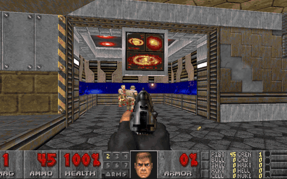
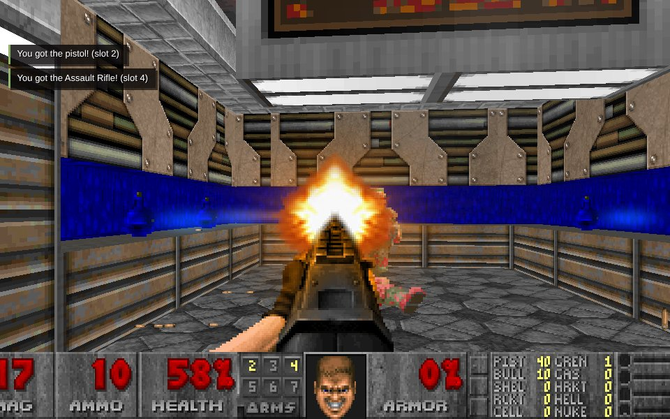
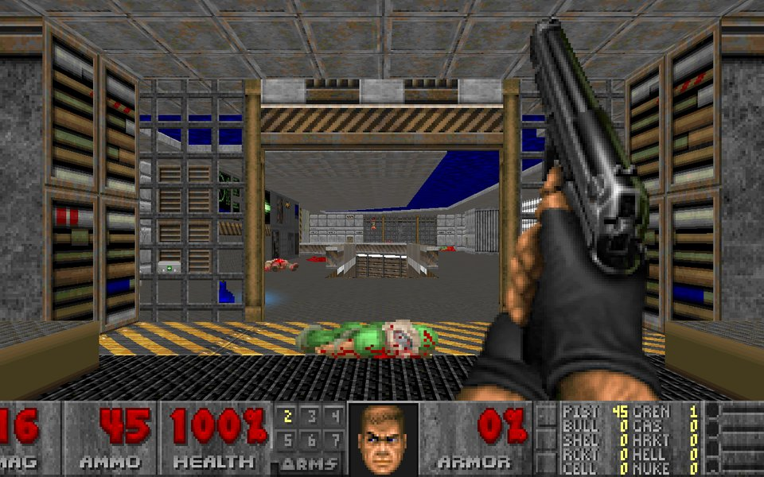
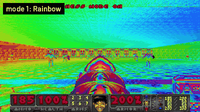
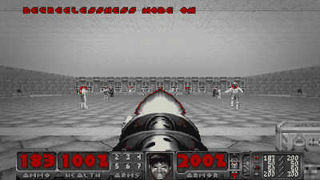
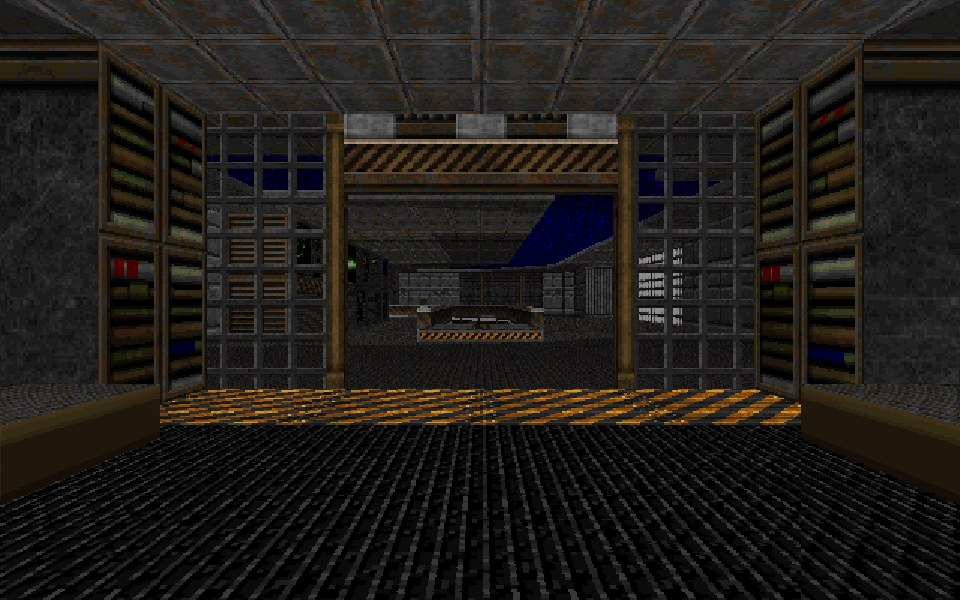
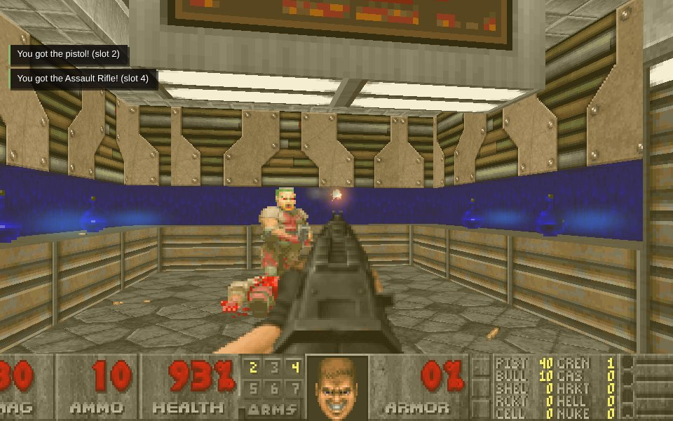
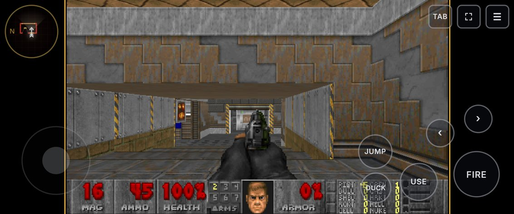
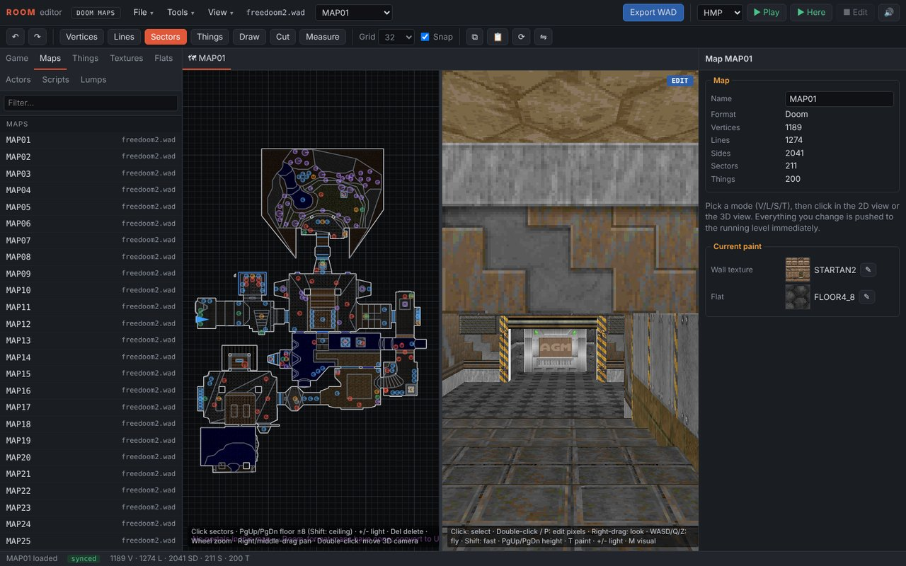

# Room

Room is a pure-Rust engine for **Doom-family games** (Doom, Doom II, Freedoom
and GZDoom/ZDoom mods: WAD, PK3, ZIP, DECORATE, ACS, ZScript) and
**Duke Nukem 3D** (a native Build-engine runtime). It runs on the desktop and
in the browser, and can compile a mod's ZScript to WebAssembly.

<p align="center">
  
</p>

<p align="center">
  
  
</p>

<p align="center"><sub>Freedoom with the Brutal Doom mod, running in Room's browser client.
Freedoom is free content, so the screenshots use it as the IWAD; any IWAD you own works the
same way. Brutal Doom is a separate download by its own authors and is not bundled with Room.</sub></p>

- What is implemented: [feature overview](docs/00-overview.md),
  [current status](docs/21-milestone-progress.md)
- Doom quick start: [Play Doom](#play-doom)
- Duke quick start: [Play Duke Nukem 3D](#play-duke-nukem-3d)
- ZScript to WebAssembly: [Convert a ZScript mod to WebAssembly](#convert-a-zscript-mod-to-webassembly)

## Contents

1. [Requirements and game data](#requirements-and-game-data)
2. [Play Doom](#play-doom)
3. [Play Duke Nukem 3D](#play-duke-nukem-3d)
4. [Convert a ZScript mod to WebAssembly](#convert-a-zscript-mod-to-webassembly)
5. [Room WASM mods](#room-wasm-mods)
6. [Browser client and multiplayer](#browser-client-and-multiplayer)
7. [Shaders & graphics CVars](#shaders--graphics-cvars)
8. [Build and develop](#build-and-develop)

## Requirements and game data

- **Rust stable** (the version is pinned by `rust-toolchain.toml`).
- **`wasm32-unknown-unknown` target**, needed only for the browser client
  and for building WASM mods such as [`mods/brutal-zscript-rs`](mods/brutal-zscript-rs/):

  ```sh
  rustup target add wasm32-unknown-unknown
  ```

- **Game data.** Room ships no commercial data. Use your own legally
  obtained files, or fetch the free [Freedoom](https://freedoom.github.io/) IWADs:

  ```sh
  ./scripts/fetch-freedoom.sh
  ```

  The launch scripts look for these paths by default. Any other location can
  be passed with `--iwad` (Doom) or `ROOM_IWAD` (Duke).

  | Game | File | Default path |
  |---|---|---|
  | Doom (shareware or registered) | `DOOM1.WAD` / `DOOM.WAD` | `testdata/doom/doom1.wad` |
  | Doom II | `DOOM2.WAD` | `testdata/doom/doom2.wad` |
  | Freedoom Phase 1 / 2 | `freedoom1.wad` / `freedoom2.wad` | `testdata/freedoom/` |
  | Duke Nukem 3D (shareware or full) | `DUKE3D.GRP` | `testdata/duke/duke3d.grp` |

The launch scripts build `room-app` in release mode and then start it. The
first run takes a while.

## Play Doom

### Quick start

```sh
./scripts/play-doom.sh --game doom1                  # Doom, E1M1
./scripts/play-doom.sh --game doom2 --map MAP02      # Doom II, MAP02
./scripts/play-doom.sh --game freedoom2              # Freedoom Phase 2
```

### Launcher options

| Option | Meaning |
|---|---|
| `--game doom1\|doom2\|freedoom1\|freedoom2` | IWAD preset from `testdata/` (default `doom1`, or `doom2` for Brutal Doom) |
| `--iwad PATH` | Any IWAD; overrides `--game` |
| `--map NAME` | Start map (default `E1M1`, or `MAP01` for Doom II) |
| `--file PATH` | PWAD / PK3 / ZIP mounted after the IWAD; repeatable, load order is kept |
| `--skill N` | Skill 1–5 (default 3, Hurt Me Plenty) |
| `--title` | Stay on the title screen instead of starting the map |
| `--no-zscript-debug` | Hide the ZScript load trace |
| `-- <args>` | Forward the remaining options to `room-app` (for example `--god`, `--give-all`, `--set cvar=value`) |

Run `./scripts/play-doom.sh --help` for the current list.

### Load mods

Pass each mod with `--file`, in the order GZDoom would load it. Choose the
IWAD the mod was made for.

```sh
./scripts/play-doom.sh --iwad ~/games/doom/doom2.wad --map MAP01 \
  --file ~/mods/my-mod.pk3 --file ~/mods/my-patch.wad --skill 4
```

To see what a mod uses that Room does not support yet (DECORATE, ACS and
ZScript gaps), before playing it:

```sh
cargo run --release -p room-cli -- mod check ~/mods/my-mod.pk3 \
  --iwad ~/games/doom/doom2.wad --md mod-report.md
```

To see what a file is and what it holds (game or release, maps with their
format, size and title, content counts, definition lumps, GAMEINFO,
embedded WADs), for any file Room loads: IWAD / PWAD, PK3 / IPK3 / PKE /
ZIP, PK7 / 7Z, a mod directory, a Duke Nukem 3D GRP, Build `.MAP` / `.ART`
files and DeHackEd patches:

```sh
cargo run --release -p room-cli -- inspect ~/games/doom/doom2.wad ~/mods/my-mod.pk3
# --lumps lists every lump, --all-maps every map, --json for scripts
```

### Brutal Doom

The launcher recognizes Brutal Doom by file name or by its `GAMEINFO` and
then uses Doom II and MAP01 automatically:

```sh
./scripts/play-doom.sh --file ~/mods/brutal22test6.pk3
```

Brutal Doom's ZScript can run three ways: interpreted (the default), from
an automatically converted WebAssembly package (see
[below](#convert-a-zscript-mod-to-webassembly)), or from the Rust hand-port
in [`mods/brutal-zscript-rs`](mods/brutal-zscript-rs/README.md). Background:
[docs/33](docs/33-brutal-doom.md).

### Colour mods: Color World and Red Noir

Two small mods change the colours of the whole 3D view (the weapon
included; the status bar keeps its colours) with a GLDEFS post-process
shader driven by ZScript. They are plain GZDoom mods, so they also work in
GZDoom, and they stack with Brutal Doom.

<p align="center">
  
  
</p>

[**Color World**](mods/colorworld/README.md) (left) has ten looks, picked
with `colorworld_mode` or in Options → Color World: rainbow, rainbow
bands, hue cycle, grayscale, sepia, inverted, thermal, Game Boy, neon edges.
[**Red Noir**](mods/rednoir/README.md) (right) turns the world black, white
and grey and keeps only the red of blood (`noir_mode`, contrast, film grain
and dark corners in Options → Red Noir).

```sh
./scripts/play-doom.sh --file ~/mods/brutal22test6.pk3 --colors rainbow
./scripts/play-doom.sh --file ~/mods/brutal22test6.pk3 --noir
./scripts/play-doom.sh --noir --set noir_grain=0   # any option: --set NAME=VALUE
```

`--colors` and `--noir` build the mod's PK3 when needed
(`mods/<mod>/pack.sh`). The room server also packs both into its mod
catalog, so the lobby offers them in **Play solo** and for new rooms once an
admin allows them (Settings → Mods).

### Two renderers

The GPU renderer (wgpu: desktop, WebGPU or WebGL 2 in the browser) is the
default. A classic 8-bit software renderer ([docs/40](docs/40-software-renderer.md))
draws the same map the way vanilla Doom did; `room soft-view` renders one
frame of it to a PNG:

```sh
cargo run --release -p room-cli -- soft-view testdata/freedoom/freedoom1.wad \
  --map E1M1 --width 640 --height 400 -o e1m1.png
```

<p align="center">
  
</p>

### Controls

WASD or the arrows move, the mouse looks around once the game view is
clicked, Ctrl or the left mouse button fires, E or Space uses, 1–7 switch
weapons, Esc opens the menu, F5 opens graphics options, F12 takes a screenshot
and F11 starts or stops a GIF recording (saved under `room/screenshots`).

## Play Duke Nukem 3D

### Quick start

```sh
./scripts/play-duke3d.sh                      # E1L1, Hollywood Holocaust
ROOM_MAP=E2L1 ./scripts/play-duke3d.sh        # another episode/level
ROOM_SKILL=4 ./scripts/play-duke3d.sh         # another skill
```

The GRP is read from `testdata/duke/duke3d.grp`; set `ROOM_IWAD` to use
another file:

```sh
ROOM_IWAD=~/games/duke/DUKE3D.GRP ./scripts/play-duke3d.sh
```

### Runtimes

| Runtime | How it works | Select with |
|---|---|---|
| `native` (default) | Loads the original Build maps and runs the `room-duke` simulation (CON VM, Build physics) | `--runtime native` |
| `converter` | Older path: converts the GRP to UDMF and plays it on the Doom playsim | `--runtime converter` |

`ROOM_DUKE_RUNTIME` sets the default runtime. The converter runtime fetches a
SoundFont for MIDI music on first use and supports `ROOM_TITLE=1`.

### Options (native runtime)

| Option / variable | Meaning |
|---|---|
| `ROOM_MAP=ExLy` | Start level (default `E1L1`) |
| `ROOM_SKILL=N` | Skill (default 3) |
| `--grp PATH` | Mount an add-on GRP after the base one (repeatable) |
| `--map PATH` | Load a standalone Build `.MAP` file |
| `--con PATH` | Replace the root CON script (like `-x` in the original game) |
| `--give-all` | Give every weapon with full ammo |

```sh
./scripts/play-duke3d.sh --grp addon.grp
./scripts/play-duke3d.sh --map ~/maps/custom.map
./scripts/play-duke3d.sh --con custom.con --give-all
```

### Controls (native runtime)

WASD moves and strafes, the mouse or Q and the arrows turn, L toggles mouse
look, Space jumps, Ctrl, F or the left mouse button fires, 1–0 switch weapons,
and E uses tagged switches and doors. F12 and F11 take screenshots and GIFs,
as in Doom.

### Status

Native Duke is in active development. Atomic Edition maps, movement, basic
enemy simulation and several weapons work. Some weapons, sector effects,
music and ambient audio, level exits and campaign progression are not done
yet. See [Duke support](docs/25-duke3d-full-support.md) and the
[Build engine overview](docs/23-build-engine.md).

## Convert a ZScript mod to WebAssembly

Room compiles a mod's ZScript to its own bytecode and runs it on the ZVM
interpreter. It can also compile that bytecode to **WebAssembly**, which
wasmtime/Cranelift (desktop) or the browser's JIT turn into machine code. The
interpreter stays the reference: compiled code must give the same results tic
for tic, and anything the compiler does not handle falls back to the
interpreter.

| Approach | What you get | When to use it |
|---|---|---|
| **Interpreter** (default) | Mod loaded as is | Always works; the reference behaviour |
| **AOT at load time** (`ROOM_ZVM_TIER=aot`) | ZScript compiled to WASM each time the mod loads | Try the compiled tier on an unmodified mod |
| **Converted package** (`room mod convert`) | A new PK3 shipping a precompiled, verified `room/zscript.wasm` | Distribute or replay a mod with the compiled tier and no compile step |
| **Hand-port to Rust** ([docs/39](docs/39-zscript-to-rust-mods.md)) | The mod's ZScript rewritten as a Rust WASM mod | Make the logic readable, testable and editable (example: [`mods/brutal-zscript-rs`](mods/brutal-zscript-rs/README.md)) |

### 1. Check the mod (optional)

The coverage report lists the natives the program uses, which ones this build
lacks, and which functions stay interpreted:

```sh
cargo run --release -p room-cli -- zscript wasm ~/mods/my-mod.pk3 \
  --report zscript-coverage.md
```

### 2. Convert it

```sh
cargo run --release -p room-cli -- mod convert ~/mods/my-mod.pk3 \
  -o ~/mods/my-mod-room.pk3 \
  --iwad ~/games/doom/doom2.wad --map MAP01 --skill 3
```

The converter:

1. compiles the mod's ZScript with Room's frontend, then to WebAssembly;
2. writes a new PK3 with every original entry except the ZScript sources, plus
   `room/zscript.wasm` (and `room/zscript_ui.wasm` when the mod defines a
   status bar class);
3. **verifies** the result: it plays the original (interpreter) and the
   converted package (WASM) headless with scripted input for 2,000 tics,
   saves and reloads both halfway, and compares world and ZScript checksums
   every tic;
4. writes `room/convert.json` with missing natives and whether verification
   passed.

| Option | Default | Meaning |
|---|---|---|
| `-o, --out PATH` | required | Output `.pk3` |
| `--iwad PATH` | `ROOM_IWAD` | IWAD used for verification; use the one the mod targets |
| `--map NAME` | `MAP01`, else `E1M1` | Verification map |
| `--verify N` | `2000` | Tics to compare; `0` skips verification (not for a package you will use) |
| `--skill N` | `3` | Verification skill |
| `--keep-zscript` | off | Keep the sources in the package under `room/zscript-src/` |
| `--allow-missing-natives` | off | Convert even if the program calls natives this build lacks |

The input can be a `.pk3`, a `.zip` or a directory.

### 3. Play the converted package

Load it **instead of** the original mod:

```sh
./scripts/play-doom.sh --iwad ~/games/doom/doom2.wad --map MAP01 \
  --file ~/mods/my-mod-room.pk3
```

Room loads `room/zscript.wasm` directly, without compiling ZScript, and prints
`zscript: converted mod module attached (…)`. It warns when
`room/convert.json` does not record `"verified": true`.

### Runtime tier options

| Variable | Effect |
|---|---|
| *(unset)* | Converted package: runs the shipped module. Unconverted mod: interpreter |
| `ROOM_ZVM_TIER=aot` | Unconverted mod: compile its ZScript to WASM at load time and use it (log line `zscript: aot tier on …`) |
| `ROOM_ZVM_TIER=aot-all` | As `aot`, but every function is entered through WASM, including short ones the default policy keeps on the interpreter |
| `ROOM_ZVM_TIER=interp` | Force the interpreter, even for a converted package |
| `ROOM_ZVM_ENGINE=wasmi` | Use the wasmi interpreter instead of wasmtime as the WASM engine |

```sh
ROOM_ZVM_TIER=aot ./scripts/play-doom.sh --file ~/mods/brutal22test6.pk3
```

In the browser client, `?zvm=aot` (or `?zvm=aot-all`) selects the same tier.
That path is implemented but has not yet been tested in a browser.

### Other `room zscript wasm` commands

```sh
# Write the module and its text form, and compare every function
# on the interpreter and the module
cargo run --release -p room-cli -- zscript wasm ~/mods/my-mod.pk3 \
  --out my-mod.wasm --wat my-mod.wat --check

# Coverage of the vendored UZDoom ZScript library
cargo run --release -p room-cli -- zscript wasm --stdlib --report stdlib-coverage.md
```

### Limitations

- A converted package is tied to Room's ZScript native table: it needs a
  compatible Room build. It is not a standalone `ROOMMOD` ABI v1 module and
  does not run in GZDoom.
- The mod's ZScript program is converted as a whole. Loading other
  unconverted ZScript next to a converted package is not supported.
- Do not load the original mod and its converted package together.
- Resolve missing natives or failed verification before relying on a package.

Details: [ZScript-to-WASM guide](docs/37-zscript-to-wasm.md) (format,
verification, performance, status).

## Room WASM mods

Room also runs standalone mods written against its ABI v1 in Rust,
AssemblyScript or Python, packed in a WAD with a `ROOMMOD` manifest. This is
separate from converting an existing ZScript mod. Examples are in
[`mods/`](mods/); the [scripting guide](docs/12-wasm-scripting.md) explains
the ABI and the SDK.

```sh
# Build the example mods into WAD packages
./scripts/room-server.sh mods

# Run one on Doom
./scripts/play-doom.sh --game doom1 --file mods/doom1-bounty/bounty.wad
```

When mods load, Room prints `room: WASM mods: …`. The Python example is
desktop-only, needs the Python-mod feature and is not deterministic enough
for netplay; see [`mods/doom1-python-hello`](mods/doom1-python-hello/README.md).

## Browser client and multiplayer

```sh
# Build and serve the browser client
./scripts/play-web.sh

# Local multi-room server
./scripts/room-server.sh start
./scripts/room-server.sh status
./scripts/room-server.sh stop
```

The browser client uses locally supplied Doom or Freedoom IWADs. Click the
canvas for mouse look and press a key to enable audio. The server serves the
lobby at `http://127.0.0.1:8765/` and the client at
`http://127.0.0.1:8765/play/`. For deployment and Docker, see
[`deploy/README.md`](deploy/README.md).

<p align="center">
  
  
</p>

On phones the client shows touch controls: a move stick, look by dragging,
and buttons for fire, use, jump, duck and weapons. The minimap becomes a small
radar in the top-left corner; tap it for a full-size map. In solo games,
opening Settings pauses the game.

### Map editor

The browser client ships a map editor (`editor.html`, also linked from the
in-game menu): a 2D view and a live 3D view side by side, with vertex, line,
sector and thing modes, texture painting, prefabs, an ACS compiler with
completion, snapshots, and one-click play-testing of the map you are editing.
Edits export as a WAD.

<p align="center">
  
</p>

## Shaders & graphics CVars

Modern look effects are **off by default**. Change them from:

| Where | How |
|---|---|
| Desktop console | `set gl_bloom 1`, `set r_quality 2`, … |
| Desktop menu | Options → **Graphics** (F5 in-game) |
| CLI | `--set gl_bloom=1 --set r_gore=2` |
| Web | Settings → **Graphics** (**Reset shaders to defaults** restores the faithful look) |
| Web JavaScript | `roomSetShaderCvar("gl_bloom", "1")` |

`--combat-demo` resets shader CVars on start and does not write them to
`room.ini`.

### Quality presets (`r_quality`)

| Value | Name | Summary |
|---|---|---|
| `0` | Faithful | Modern effects off |
| `1` | Low | Soft tonemap, FXAA, bloom, soft particles, hitflash, muzzle/tracers/impact/kick |
| `2` | Medium | AgX, SMAA→FXAA, bloom, SSAO, outlines, color grade, damage effects, liquids |
| `3` | Ultra | Khronos tonemap, TAA→FXAA, stronger SSAO/bloom, heat haze, shafts, enhanced gore |

### Graphics CVar catalogue

**Post-processing and look**

| CVar | Values | Default | Notes |
|---|---|---|---|
| `gl_tonemap` | `0`–`8` | `0` | 0 none … 6 AgX, 7 Khronos, 8 RoomSoft |
| `r_exposure` | float | `1` | Pre-tonemap exposure |
| `r_gamma` | float | `1` | Display gamma (post) |
| `gl_fxaa` / `r_aa` | `0`–`3` | `0` | 0 off, 1 FXAA, 2 SMAA→FXAA, 3 TAA→FXAA |
| `r_sharpen` | `0`–`1` | `0` | CAS-lite sharpen |
| `gl_bloom` | `0`/`1` | `0` | Soft bloom |
| `gl_bloom_amount` | float | `0.8` | Bloom strength |
| `gl_ssao` | `0`–`3` | `0` | Screen-space AO (Full GPU tier) |
| `gl_ssao_strength` | float | `1` | AO intensity |
| `r_postchain` | `0`/`1`/`2` | `0` | 0 auto, 1 force on, 2 force off |
| `r_crt` | `0`/`1` | `0` | CRT barrel and scanlines |
| `r_crt_preset` | `0`–`2` | `0` | 0 off, 1 TV, 2 PC monitor |
| `r_dither` | `0`/`1` | `0` | Bayer dither |
| `r_banding` | `0`/`1` | `0` | 5-bit banding |
| `r_vignette` | `0`–`1` | `0` | Edge darken |
| `r_grain` | `0`–`1` | `0` | Film grain |
| `r_chromatic` | `0`–`1` | `0` | Chromatic aberration |
| `r_damagefx` | `0`/`1` | `0` | Low-health red edge |
| `r_colorgrade` | `0`/`1` | `0` | Mild grade |
| `r_autoexposure` | `0`/`1` | `0` | Exposure from sector light |
| `r_powerupfx` | `0`/`1` | `0` | Suit / IR tint |
| `r_underwaterfx` | `0`/`1` | `0` | Underwater CA and tint |
| `r_menublur` | `0`/`1` | `0` | Soften scene behind menus |
| `r_dof` / `r_motionblur` | `0`/`1` | `0` | Soft stand-ins |
| `vid_scalefactor` | float | `1` | Internal scale (&lt;1 = upscale) |
| `vid_scalemode` | int | `0` | Upsample mode |

**Actors and atmosphere**

| CVar | Values | Default | Notes |
|---|---|---|---|
| `r_softparticles` | `0`/`1` | `0` | Soft disc fade |
| `r_particlefx` | `0`/`1` | `0` | Motion-stretch particles |
| `r_outlines` | `0`/`1` | `0` | Edge pop |
| `r_hitflash` | `0`/`1` | `0` | Bright flash on hit actors |
| `r_actorspriteshadow` | `0`/`1` | `0` | Floor blob under monsters |
| `r_dissolve` | `0`/`1` | `0` | Death dissolve particles |
| `r_liquids` | `0`–`2` | `0` | Liquid / underwater look |
| `r_heathaze` | `0`/`1` | `0` | Explosion heat CA |
| `r_parallax` / `r_ssr` / `r_detail` / `r_skyfx` / `r_decalfx` | `0`/`1` | `0` | Partial / later |
| `r_lightshafts` / `r_volfog` / `r_ambientbounce` | `0`/`1` | `0` | Lighting extras |
| `gl_shadowmap_filter` | `0`–`2` | `0` | Shadow filter quality |
| `gl_light_sprites` / `gl_lightmap` / `r_autonormals` | `0`/`1` | `0` | Sprite / lightmap |
| `r_hudfx` | `0`/`1` | `0` | Mod HUD widget effects |
| `r_gpuprofile` | `0`/`1` | `0` | GPU profiler (WIP) |

**Weapons and blood** (`r_gore` gates blood layers)

| CVar | Values | Default | Notes |
|---|---|---|---|
| `r_gore` | `0`–`3` | `1` | 0 none … 3 full |
| `r_bloodfx` | `0`/`1` | `0` | Spray and floor/wall splats (`r_gore` ≥ 2) |
| `r_blooddrips` | `0`/`1` | `0` | Wall drips |
| `r_bloodwet` | `0`/`1` | `0` | Wet shading (stub) |
| `r_corpsepools` | `0`/`1` | `0` | Pool under corpses |
| `r_gibs` | `0`/`1` | `0` | Extra gib particles |
| `r_screenblood` | `0`/`1` | `0` | Lens blood on heavy damage |
| `r_weaponblood` / `r_wounds` | `0`/`1` | `0` | Stub |
| `r_muzzlefx` | `0`/`1` | `0` | Muzzle flash particles |
| `r_tracers` | `0`/`1` | `0` | Hitscan tracers |
| `r_impactfx` | `0`/`1` | `0` | Wall impact sparks |
| `r_viewkick` | `0`/`1` | `0` | Render-only camera kick |
| `r_viewkick_scale` | float | `1` | Kick strength (`0`–`4`) |
| `r_explosionfx` | `0`/`1` | `0` | Explosion fireball particles |
| `r_trails` | `0`/`1` | `0` | Missile smoke |
| `r_casings` | `0`/`1` | `0` | Ejected shells |
| `r_weaponsmoke` | `0`/`1` | `0` | Barrel smoke |
| `r_hitconfirm` | `0`/`1` | `0` | Flash on confirmed hit |
| `r_reduce_flashing` | `0`/`1` | `0` | Photosensitivity cap |

For example, enable a few combat effects with:

```sh
cargo run -p room-app --release -- --combat-demo --skill 4 \
  --set r_gore=2 --set r_bloodfx=1 --set r_blooddrips=1 \
  --set r_muzzlefx=1 --set r_tracers=1 --set r_impactfx=1 --set r_viewkick=1
```

## Build and develop

```sh
cargo fmt --all
cargo clippy --all-targets -- -D warnings
cargo test --workspace
cargo build --target wasm32-unknown-unknown -p room-web --features browser
```

Read [architecture](docs/01-architecture.md), [conventions](docs/02-conventions.md)
and [roadmap/testing](docs/20-roadmap-testing.md) before working on engine
code. Each crate in `crates/` has a README describing its responsibilities.

## Licence

**GPL-3.0-or-later.** Behaviour reference: [GZDoom](https://github.com/ZDoom/gzdoom)
and the [ZDoom wiki](https://zdoom.org/wiki/Main_Page).
