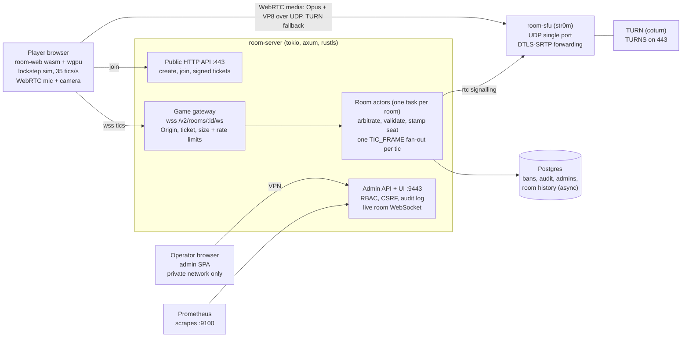

# 22 — Room multiplayer server (web): technical specification

Status: proposal · 2026-10-13

## 1. Purpose and instructions for the implementing LLM

Build `room-server`: a production replacement for the dev relay `crates/room-ws` that hosts thousands of concurrent Room web-coop games, ships with an admin UI, and adds WebRTC audio/video. It must stay wire-compatible with the browser client in `crates/room-web` during migration.

**Context.** Room is a pure-Rust, library-first re-implementation of ZDoom/GZDoom (workspace at the repo root, edition 2024, GPL-3.0-or-later). Web multiplayer is deterministic **lockstep at 35 tics/s**: browsers exchange per-tic input commands through a WebSocket packet-server; every client runs the full simulation. The server never needs to run the game to relay it.

**Rules you must follow (from `AGENTS.md`):**

1. Read `AGENTS.md`, `docs/17-netplay-demos-saves.md` and `docs/18-platform-web.md` before writing code.
2. Pure Rust only. No crate that builds C/C++ unless listed in `docs/appendix-a-dependencies.md`. External services (TURN, Postgres) are fine because they are not linked.
3. `unsafe_code = "deny"`, `clippy::unwrap_used = "deny"`. Every function taking untrusted bytes returns `Result`, never panics, and gets a `cargo fuzz` target.
4. Do not change `room-sim` determinism or the lockstep model. Server work lives in new crates; client changes are limited to `room-net`, `room-web` and `voice.js`.
5. Record design decisions as ADRs in `docs/decisions/NNNN-title.md`; update `docs/21-milestone-progress.md` as work lands.
6. Gate every milestone on: `cargo fmt --all`, `cargo clippy --all-targets -- -D warnings`, `cargo test --workspace`, `cargo build --target wasm32-unknown-unknown -p room-web`, plus the acceptance tests in §9.

**Deliverables:** crates `room-proto` (wire types + codecs), `room-server` (binary), `room-admin-ui` (static SPA served by the server), client changes in `room-net` / `room-web`, ADRs, load-test harness, deployment files.

## 2. What exists today

Today's `room-ws` is a 273-line local dev relay: one process serves exactly one game of 2–8 seats, with no TLS, no auth and no limits. Everything below was read from the repo on 2026-10-13.

**Data path.** The browser (`room-web/src/ws_net.rs`) opens `ws://host:8765`, sends `MSG_HELLO`, gets `MSG_WELCOME{seat, peer_count}`. Lobby messages (`FNHS` magic, `room-net/src/lobby.rs`: Hello/Welcome/Reject/Start/Ready) and per-tic commands ride inside `MSG_DATA`. Seat 0 (a browser tab) is the lobby arbitrator: it picks map, skill and RNG seed and validates the IWAD fingerprint. After every seat sends `Ready`, lockstep starts at tic 0 with input delay 0.

**Relay framing (`room-net/src/relay.rs`)** — one WebSocket binary message = `"FTRL"` + `u8 type` + payload:

| Type | Name | Direction | Payload |
| --- | --- | --- | --- |
| 1 | HELLO | C→S | `u16le len` + UTF-8 name (≤64 B) |
| 2 | WELCOME | S→C | `u8 seat`, `u8 peer_count` |
| 3 | DATA | C→S / S→C | client: raw bytes; server: `u8 from_seat` + bytes |
| 4 | REJECT | S→C | `u16le len` + reason (≤200 B) |
| 5 | VOICE | C→S / S→C | same as DATA; raw PCM frames |
| 6 | PEER\_JOIN | S→C | `u8 seat`, `u16le len`, name |
| 7 | PEER\_LEAVE | S→C | `u8 seat` |

**Tic command (`encode_timed_cmd`, 23 bytes):** `u8 version=1`, `u8 peer`, `u32 tic`, `u32 buttons`, `i16 pitch, yaw, roll, forward, side, up`, `u8 weapon_select`. Clients re-broadcast their pending command every 2 render frames until the tic advances. After 45 frames waiting on a departed peer (1,800 frames if the peer is merely silent), the client fills default commands.

**Voice (`room-web/voice.js`).** Push-to-talk (V). AudioWorklet captures 960-sample frames; payload `[1=PCM][u32 seq][u32 rate][u8 ch][i16le samples]`, uncompressed 48 kHz mono, about 768 kbit/s per talker. Not encrypted end-to-end. Relay drops voice payloads over 8 KiB.

**Gaps the new server must close:**

| # | Gap in `room-ws` | Impact |
| --- | --- | --- |
| G1 | One room per process; `--players` fixed at launch | Cannot host many games |
| G2 | Thread per client + 2 ms busy-poll loops (accept loop and every client thread) | CPU burn, poor scaling |
| G3 | Unbounded `mpsc` outbox per client | A slow reader grows server memory without limit |
| G4 | Plain `ws://`; no Origin check, no auth, no tickets | Anyone can join any game; traffic readable |
| G5 | Lowest free seat reused on reconnect | A stranger can grab seat 0 and become arbitrator |
| G6 | `LockstepSession::recv` ignores the relay's sender and trusts the `peer` byte inside the command | **Any client can forge or overwrite another player's inputs** |
| G7 | No size cap on DATA (tungstenite default max message is 64 MiB) and no rate limits | Memory and bandwidth DoS |
| G8 | Arbitration (map, seed, Start) runs in a browser tab | Host can cheat or stall; host leaving kills the game |
| G9 | Desync checksums every 35 tics are specified in docs/17 §1.2 but not wired in `room-web` | Desyncs go undetected |
| G10 | Raw PCM voice, no video, no mute/moderation | Bandwidth-heavy; no admin control |
| G11 | No metrics, logs only to stderr, no admin surface | Operators are blind |

## 3. Target architecture

One async Rust binary, `room-server`, runs every room as an isolated actor task; game traffic, the admin plane and media are separate listeners so each can be locked down and scaled on its own.



Game input flows browser → gateway → room actor and back as one frame per tic; WebRTC media goes straight to the SFU, which the room actor only signals; operators reach the admin plane over a private network.

**Stack (all pure Rust):** `tokio` (multi-thread runtime), `axum` + `tokio-tungstenite` (HTTP + WebSocket), `rustls` (TLS), `bytes::Bytes` (zero-copy fan-out), `str0m` (sans-IO WebRTC SFU), `sqlx` with Postgres (or SQLite for single-node) for bans, audit and room history, `tracing` + `metrics` with a Prometheus exporter, `jsonwebtoken` or `pasetors` for tickets, `argon2` for admin passwords, `webauthn-rs` for admin passkeys. Coturn runs as an external TURN service.

**Components:**

| Component | Listener | Responsibility |
| --- | --- | --- |
| Public HTTP API | `:443` `/api/*` | Create/list/join rooms, issue join tickets, health |
| Game gateway | `:443` `/v2/rooms/{room_id}/ws` | WebSocket per player; auth, framing, rate limits, hands frames to the room actor |
| Legacy gateway | `:443` `/ws` (feature `legacy-ftrl`) | Old `FTRL` clients, one anonymous room per URL token; removed after migration |
| Room actor | in-process task | Owns seats, lobby, arbitration, tic validation, fan-out, checksum compare, media roster |
| Room registry | in-process | `DashMap<RoomId, RoomHandle>`; caps, lookup, shutdown |
| SFU | UDP `:3478`-range + ICE-TCP `:443` fallback | Forwards Opus audio and VP8/VP9 video between room members |
| Admin API + UI | `:9443`, private network only | REST + live WebSocket for operators; serves the SPA |
| Metrics | `:9100` `/metrics`, private | Prometheus scrape |
| Store | Postgres | Bans, admin users, audit log, room history; never on the per-tic hot path |

**Room actor model.** Each room is one `tokio` task owning all its state; there are no locks on the hot path. Connections talk to it through a bounded `mpsc::Sender<RoomCmd>` (capacity 256). The actor sends to each player through that player's bounded outbound queue (§6). A panic or error in one room ends only that room (wrap in `tokio::spawn` + `JoinHandle` supervision; log, notify admins, free seats).

```rust
enum RoomCmd {
    Join { conn: ConnId, ticket: Claims, tx: PlayerTx },
    Frame { conn: ConnId, frame: ClientFrame },   // already decoded + size-checked
    Leave { conn: ConnId, reason: LeaveReason },
    Admin(AdminCmd),                              // kick, mute, close, set_settings
    Tick,                                         // 1 Hz housekeeping timer
}
```

**Scale-out.** Phase 1 is a single node (target 2,000 rooms / 10,000 connections on 4 vCPU, §6). Phase 2 runs N stateless-to-each-other nodes; a room lives on exactly one node. The join API picks a node (least rooms) and returns a node-specific WebSocket URL inside the ticket, so no cross-node traffic is needed. A small Postgres table `room_location(room_id, node_id, heartbeat)` lets any API node route joins and lets the admin UI list rooms cluster-wide. Do not add Redis unless profiling demands it.

**Optional server-side verifier (phase 3).** `room-game::Headless` is deterministic, so the room actor can run the same sim from the same inputs on a worker thread (`spawn_blocking` pool, bounded). That makes the server the source of truth for checksums, enables late join and reconnect by sending a save snapshot (`room-game/src/save.rs`), and records server-side demos (`.fdem`). It costs CPU per room, so make it a per-room flag with a global cap.

## 4. Protocol v2 and room lifecycle

The server becomes the arbitrator and the only sender of tic frames: clients send their own input, the server validates it, stamps the seat, and broadcasts one combined frame per tic. This removes forgery (G6), host cheating (G8) and divergent stall handling in one change.

**Framing.** WebSocket binary frames carry the hot path; text frames carry JSON control messages. Put all types and codecs in a new crate `room-proto` (no I/O, `#![forbid(unsafe_code)]`, compiled for both native and `wasm32`), with a fuzz target per decoder.

- Binary: `"FTR2"` + `u8 type` + payload. Max 512 bytes client→server (except VOICE\_LEGACY, 4 KiB).
- Text: one JSON object `{"t": "<type>", ...}`, parsed with `serde` and `#[serde(deny_unknown_fields)]`. Max 4 KiB. Strings are length-checked and Unicode-normalized (NFKC) before use.

**Binary messages:**

| Type | Name | Dir | Payload | Rule |
| --- | --- | --- | --- | --- |
| 0x10 | TIC\_CMD | C→S | `u32 tic` + 17-byte `NetTicCmd` body (no peer byte) | Seat comes from the connection, never the payload |
| 0x11 | TIC\_FRAME | S→C | `u32 tic`, `u8 seat_mask`, then one `NetTicCmd` per set bit | Sent once per tic when every active seat has a cmd |
| 0x12 | CHECKSUM | C→S | `u32 tic`, `u64 world_checksum` | Every 35 tics (docs/17 §1.2) |
| 0x13 | PING / 0x14 PONG | both | `u64 nonce`, `u64 server_time_us` | RTT shown in admin UI |
| 0x15 | TIC\_BATCH | S→C | `u16 count`, then `count` TIC\_FRAME bodies back to back | Spectator catch-up only; ≤256 frames, ≤64 KiB |
| 0x1F | VOICE\_LEGACY | both | old PCM layout | Only until the SFU ships; off by default |
| 0x16 / 0x17 | TIC\_FRAME\_WIDE / TIC\_BATCH\_WIDE | S→C | protocol v3: `u64` seat mask (rooms past 8 seats); see `38 §3.2` | Rooms of ≤ 8 seats keep sending 0x11 / 0x15 |

**JSON control messages:**

| `t` | Dir | Fields |
| --- | --- | --- |
| `hello` | C→S | `ticket`, `client_version`, `abi_major`, `iwad_fingerprint` (u64 hex), `resume_token?` |
| `welcome` | S→C | `seat`, `room` {map, skill, max\_players, rng\_seed, delay, `mod?` {name, title, fingerprint, size}}, `resume_token`, `roster[]`, `media` {enabled, ice\_servers\[\]} |
| `reject` | S→C | `code` (enum), `reason` |
| `roster` | S→C | `seats[]` {seat, name, state: lobby/loading/ready/playing/away, muted} |
| `ready` | C→S | `{}` after map load |
| `start` | S→C | `tic0`, `rng_seed` |
| `chat` | both | `text` (≤200 chars); server adds `from`, `ts` |
| `desync` | S→C | `tic`, `seats[]` that disagreed |
| `rtc` | both | WebRTC signalling: `{kind: offer/answer/ice/track, sdp?, candidate?, mid?}` (§8) |
| `notice` | S→C | admin broadcast text, kick reason, shutdown warning |
| `bye` | S→C | `code`, `reason` before close |
| `result` | C→S | `winner` (seat or null), `time_up`, `standings: [{seat, place, frags, deaths, damage?}]` — sent once by each seat when its sim ends the match |

**Match end, time limit, leaderboard.** Every room has a time limit in minutes
(`time_limit` on `POST /api/rooms`, clamped 1–180; default
`--room-time-limit-mins` / `ROOM_TIME_LIMIT_MINS`, 20). `welcome.room.time_limit`
carries it in seconds, and the deterministic sim ends the match on every seat when it
runs out (`World.match_over`, `time_up`); mods can end it earlier with
`game_end_match`. Seats report a `result`. Once more than half the connected seats agree, the
server sends a `notice` and closes the room `--match-end-grace-secs` later
(`ROOM_MATCH_END_GRACE_SECS`, 20) with `bye {code: "over"}`. A wall-clock
backstop closes it at start + limit + 30 s ("time limit reached"). Closed
rooms leave the directory. When every connected seat (≥ 2) agrees, the result
goes into `data_dir/leaderboard.json`; `GET /api/leaderboard` returns the top 10
(wins, frags, deaths, matches), shown as "Top players" in the lobby. Battle Royale
rooms (`mod: royale`) also update `data_dir/br_stats.json` (matches, wins, top-5s,
kills, damage, avg place, placement rating); `GET /api/br/leaderboard` and the lobby
**Battle Royale** tab list those rows. Quick play: `POST /api/quick-play/br` with
`{name}` create-or-joins an 8-seat public royale room (`fill_bots: true` on
`welcome.room` and `start`); the match starts when full or after
`--quick-play-timeout-secs` (default 60) with bots filling empty seats.

| `watch` | C→S | `iwad_fingerprint`, `name?`, `client_version` — join as a spectator instead of `hello` (no ticket, no seat) |
| `watching` | S→C | `room` (same as `welcome.room`), `roster[]`; followed by `start` if the match is running |

**Spectators.** The room keeps every encoded TIC\_FRAME since `start` in an append-only frame log (capped at 48 MiB ≈ several hours). A spectator receives the whole log as TIC\_BATCH messages from tic 0, paced by its send-queue capacity, then live frames. Because the playsim is deterministic, replaying the frames reproduces the match exactly; the client fast-forwards silently, then shows every player in a split-screen grid (follow mode, scoreboard). Spectators never send input, are capped at 16 per room, get the same ban and fingerprint checks as players, and receive roster / notice / bye. When the log is full, new spectators are rejected with `spectate_unavailable`.

**Display names** are de-duplicated per room (case-insensitive): a second `dup` is seated as `dup 2`. Clients never default the callsign — the web client asks for one before connecting.

**Tic handling in the room actor:**

1. Keep `next_tic` and a ring buffer `cmds[tic % 128][seat]`.
2. On TIC\_CMD from seat *s*: drop if `tic < next_tic` (stale or duplicate resend); reject and count a violation if `tic > next_tic + 70` (2 s window); if a cmd already exists for (tic, s) and differs, keep the first and count a violation; validate field ranges (`weapon_select` ≤ slot count, moves within `room-sim` max values).
3. When all active seats have `next_tic`, encode one TIC\_FRAME into a `Bytes` once, push it to every player queue, advance `next_tic`. Loop, since several tics may complete at once.
4. **Stall policy is server-authoritative:** the server clocks tics at 35 Hz — frame N is never released before `start + N·T` and is released as soon as every seat has sent it. A seat still missing `stall_fill_ms` (default 30) after the slot gets its last cmd repeated (weapon change cleared) for 3 tics, then a neutral cmd. Clients stream input `ceil((RTT+15 ms)/T)` tics ahead of the newest frame and use the server's copy of their own cmd. Clients must never fill defaults themselves in v2; remove `fill_defaults_for_next_tic` from the v2 web path.
5. Checksums: collect per tic; on mismatch broadcast `desync`, store both values in the room event log, and expose a "request dump" admin action.

**Room lifecycle:**

1. **Created** — `POST /api/rooms` with {map, skill, max\_players 2–64 for Doom (2–8 for Duke), visibility public/private, password?, media flags, `mod?`}. The server generates `room_id` (128-bit random, base32) and `rng_seed` from the OS CSPRNG.
2. **Lobby** — players join with tickets; first `hello` pins the IWAD fingerprint unless the creator set it. Mismatch → `reject{code: "fingerprint"}`.
3. **Loading** — creator (or auto-start when full) triggers start; server sends `welcome` settings; waits for `ready` from every seat (timeout 60 s, then drop that seat).
4. **Running** — tic relay as above.
5. **Reconnect** — a dropped seat stays reserved for `resume_grace` (default 60 s). Only a `hello` carrying that seat's `resume_token` reclaims it. Without the verifier, a reconnecting client cannot rebuild state, so v2 only supports resume during the Lobby/Loading phases, or while running if the verifier is on (snapshot sent).
6. **Ended / Closed** — all seats gone for 30 s, an admin close, or max duration (default 6 h). Write a summary row to `room_history` and free memory.

**Mods.** Rooms can run one WASM mod (`docs/12-wasm-scripting.md` §15). Every seat runs the full sim, so all seats must mount the same bytes:

1. **Catalog.** `--mods-dir` / `ROOM_MODS_DIR` names a directory of `*.wad` files that contain a `ROOMMOD` lump; it is read once at startup (files over 32 MiB, without `ROOMMOD`, or whose stem is not `[a-z0-9_-]{1,32}` are skipped with a warning). The file stem is the mod name; the title comes from the manifest's `[mod] name`. `scripts/room-server.sh start` builds every `mods/<dir>` (Rust crate or AssemblyScript; `./scripts/room-server.sh mods` builds only) and serves the resulting WADs; the Docker image ships them too.
2. **Allowing.** Catalog mods start **disallowed**. An admin allows or disallows each one in the admin console (Settings → *Mods*; `GET /admin/api/v1/mods` → `[{name, title, fingerprint, size, url, allowed}]`, `POST /admin/api/v1/mods/{name}` with `{"allowed": true|false}`, audited as `allow_mod` / `disallow_mod`). The allow list is saved in `<data-dir>/mods.json`; on the first run (no file yet) `--allow-mods` / `ROOM_ALLOW_MODS` seeds it (comma-separated names, or `*`). Disallowing only affects new rooms: running rooms keep their mod and its file stays downloadable.
3. **HTTP.** `GET /api/mods` → allowed mods `[{name, title, fingerprint, size, url}]`; `GET /api/mods/{name}.wad` serves the bytes of any catalog mod (`application/octet-stream`, `Access-Control-Allow-Origin: *`, `ETag` = fingerprint, 5 min cache). Both are on the public and lobby routers.
4. **Rooms.** `POST /api/rooms` with `"mod": "bounty"` pins the mod for the room's lifetime; an unknown name is a 400 (`unknown mod`), a disallowed one a 403, an empty string means vanilla. Optional `"packs": ["voxel"]` stacks content packs (Cheello voxel meshes, …) with the gameplay mod — known names only (`room_proto::KNOWN_PACKS`); unknown pack → 400. `GET /api/rooms` and the admin room list show the mod name and packs; the lobby UI has a *Mod* select, a *Voxel sprites* checkbox, and badges on room cards. *Play solo* skips rooms: it opens `/play/?map=…&skill=…` with `iwad=duke3d.grp` for Duke or `mod=…` / `pack=voxel` for Doom. Mods with `[mod] solo = false` in `ROOMMOD` (e.g. `royale`) are listed for room create but omitted from *Play solo*; `GET /api/mods` includes `"solo": true|false` and optional `"description"` from `[mod] description` (lobby pickers show it under the select as you change mods).
5. **Clients.** `welcome.room.mod` (and `watching.room.mod`) carries `{name, title, fingerprint, size}`; the field is omitted for vanilla rooms, so old clients and servers interoperate. `welcome.room.packs` is a string list (omitted when empty). Before preparing the map the web client fetches `{http(s) of the ws origin}/api/mods/{name}.wad`, checks `content_fingerprint` (same 64-bit hash as the IWAD fingerprint, hex) and mounts it after the IWAD; packs are fetched from `/play/mods/{name}.pk3` (same host). A mismatch or download error is a lobby error, never a silent vanilla start. Solo also accepts `?mod=survival&pack=voxel`.
6. **Verifier.** The headless verifier mounts the same catalog bytes and calls `discover_mods` + `set_script_mods`, so server checksums include the mod.
7. **HUD messages.** A mod's `player_print` to everyone shows on every client; a print to one seat only on that seat's screen (and spectators following it). Unscoped sim messages (pickups, ACS `Print`) stay hidden in netplay.

Example mods shipped with the server: `bounty` (Bounty Hunter), `survival` (Survival Director) and `royale` (Battle Royale — multiplayer only: no monsters, fists only, deathmatch rules with one life, closing zone, last player standing ends the level; `mods/doom1-royale`). Rooms past four seats place the extra players on Player 5–8 starts, deathmatch starts, then free floor around Player 1's start (`38 §2`).

The legacy `FTRL` gateway has no mod field; its rooms are always vanilla.

**Compatibility.** Under feature `legacy-ftrl`, keep a gateway that speaks today's `FTRL` framing but still applies §5 limits and stamps the sender seat; deprecate it once `room-web` ships v2.

## 5. Security model

Treat every client as hostile: identity comes from a signed ticket, the seat comes from the connection, and every input is size-, rate- and range-checked before it reaches a room.

**Transport.** TLS 1.3 only (`rustls`), `wss://` only in production; HSTS on the HTTP API. Either terminate TLS in-process or behind a reverse proxy (Caddy/nginx) that forwards `X-Forwarded-For` from a configured trusted-proxy CIDR only. Security headers on every HTTP response: `Content-Security-Policy` (default-src 'self'; connect-src 'self' wss://\<host>; no inline script), `X-Content-Type-Options: nosniff`, `Referrer-Policy: no-referrer`, `Permissions-Policy` allowing camera/microphone for the game origin only. The game page needs `Cross-Origin-Opener-Policy`/`Embedder-Policy` only if it starts using `SharedArrayBuffer`.

**Identity and tickets.**

1. Players are anonymous by default (display name only); optional OIDC login can be added later without changing the room protocol.
2. `POST /api/rooms/{id}/join` (body: name, password if the room has one) returns a **join ticket**: a PASETO v4.local (or HS256 JWT) with `room_id`, `ticket_id`, `name`, `node_id`, `exp` = now + 60 s. One-time use: the server stores `ticket_id` in a short-lived set and rejects replays.
3. The WebSocket upgrade checks `Origin` against an allowlist before accepting; the first frame must be `hello` within 5 s or the socket closes (code 4401).
4. `welcome` issues a `resume_token` (256-bit random, stored hashed with SHA-256) bound to (room, seat). It is the only way to reclaim a seat; seat numbers are never reused while reserved (fixes G5).
5. Room passwords are hashed with Argon2id; compare in constant time; 5 failed joins per IP per room per 10 min → temporary block.

**Input validation and limits (defaults, all configurable):**

| Control | Default | On breach |
| --- | --- | --- |
| WebSocket max message (`max_message_size`, `max_frame_size`) | 4 KiB | Close 1009 |
| Binary TIC\_CMD length | exactly 21 bytes after header | Violation +1 |
| Client messages per second (token bucket) | burst 120, refill 90/s | Drop + violation; close 4429 after 3 s sustained |
| Client bytes per second | 16 KiB/s game, separate media budget | Same as above |
| Chat | 1 msg/s, burst 5, ≤200 chars | Drop + notice |
| Violations before kick | 50 per minute | Kick, log, optional auto-ban 10 min |
| Connections per IP | 16 | Reject at upgrade (HTTP 429) |
| Rooms created per IP | 5 per 10 min; global cap 5,000 per node | HTTP 429 / 503 |
| Handshake timeout / idle timeout | 5 s / 30 s without any frame (clients ping every 5 s) | Close |
| Display name | 1–24 chars after NFKC, no control or bidi-override chars, profanity filter hook | Reject |

**Authority and anti-cheat.** Because every client runs the full sim, lockstep cannot hide information (wallhacks remain possible), but the server must prevent input forgery and arbitration abuse: seat stamping, first-cmd-wins, range checks, server-chosen seed and map, server stall policy. With the phase-3 verifier the server's checksum is authoritative, so a client that reports a different checksum is the one flagged.

**Admin plane.** Separate listener bound to a private interface or VPN; never exposed on the public port. Admin auth = **Argon2id password**. TOTP and/or **WebAuthn / YubiKey / passkey** (pure-Rust ES256 — not `webauthn-rs`/OpenSSL) is optional: it is required on the next login only after an admin enrolls one. Bootstrap with `--admin-bootstrap user:password` or `ROOM_ADMIN_BOOTSTRAP` when `admins.json` is empty (`scripts/room-server.sh` uses `admin` / `admin`); credentials live under `--data-dir`. Session cookie `room_admin_sid` is `HttpOnly; SameSite=Strict` (+ `Secure` with `--admin-secure-cookie`), 8 h absolute lifetime; pending MFA uses `room_admin_pending`. CSRF via `X-CSRF-Token` on every mutating request. Legacy `--admin-token` bearer remains only when **no** MFA users exist (dev). Every mutating action writes an append-only `audit_log` row (who, what, target, detail, ts).

**Media.** WebRTC media is always DTLS-SRTP encrypted. TURN credentials are short-lived (RFC 8489 REST style: HMAC of `expiry:user` with a shared secret, TTL 10 min), issued only inside `welcome`. Optional E2EE via Insertable Streams / SFrame (phase 4; disables server-side recording).

**Supply chain and code hygiene.** `cargo deny` (already in repo: `deny.toml`) and `cargo audit` in CI; no `unsafe`; fuzz targets for every `room-proto` decoder and the JSON control parser; secrets only from env or files with 0600 permissions; never log tickets, tokens, passwords or IPs at info level (IPs at debug, truncated /24 in metrics).

## 6. Performance design

The relay does almost no computation, so speed comes from avoiding work: one combined frame per tic instead of N−1 copies, no allocation or JSON on the hot path, bounded queues, and no polling loops.

**Bandwidth per player at 35 tics/s** (WebSocket header included; v2 TIC\_FRAME = 2 + 5 + 4 + 1 + 17 × seats bytes):

| Room size | Legacy `FTRL` down (msgs/s) | v2 down (msgs/s) | v2 down (KB/s) | v2 up (KB/s) |
| --- | --- | --- | --- | --- |
| 2 seats | 35 + resends | 35 | 1.6 | 1.1 |
| 4 seats | 105 + resends | 35 | 2.8 | 1.1 |
| 8 seats | 245 + resends | 35 | 5.2 | 1.1 |

Legacy clients also resend their pending command every 2 render frames while waiting; v2 drops those duplicates at the server (`tic < next_tic` or identical cmd) so they never fan out. Raw PCM voice is about 96 KB/s per talker per listener; Opus through the SFU at 32 kbit/s is about 4 KB/s, 24× less.

**Hot-path rules:**

1. **Connection reader task:** read frame → check size → token-bucket → decode TIC\_CMD into a fixed `struct` (no heap) → `try_send` to the room's bounded channel. If the room channel is full, the room is overloaded: count it in metrics and close that connection with 1013.
2. **Room actor:** cmds in a fixed ring `[[Option<NetTicCmd>; 8]; 128]`; on completion encode TIC\_FRAME once into `Bytes` and clone the handle (refcount, not copy) into each player queue.
3. **Connection writer task:** bounded queue of 64 game frames (≈1.8 s). Lockstep frames cannot be dropped, so a full queue means a slow consumer → disconnect with 4408 and let the resume path handle it. Media and chat use a separate lossy queue (drop oldest).
4. Coalesce writes: drain everything queued with `SinkExt::feed`, then one `flush` (one syscall for several frames).
5. `TCP_NODELAY` on every socket. No per-room timers per tic: the room advances on input arrival; stall detection uses one `sleep_until` deadline that resets on each advance.
6. JSON is allowed only for control messages (join, roster, chat, signalling), never per tic.
7. Registry access (`DashMap`) only on join, leave and admin queries. Database writes go through a bounded background writer; never `await` the DB inside a room actor.
8. Allocator: keep the system allocator (`mimalloc`/`jemalloc` compile C, which the pure-Rust rule forbids unless an ADR allows it).
9. Raise `nofile` to 65,536; set `SO_REUSEADDR`; use `tokio` multi-thread runtime with worker count = vCPUs.

**Budgets (acceptance targets, verified by the §9 load test on a 4 vCPU / 8 GB VM):**

| Metric | Target |
| --- | --- |
| Concurrent connections | ≥ 10,000 (2,500 rooms × 4 seats) |
| Added relay latency, input in → frame out | p50 < 0.3 ms, p99 < 2 ms at 70% CPU |
| Memory | < 48 KiB per connection, < 64 KiB per room (excluding verifier) |
| CPU | < 0.3 core per 1,000 active players |
| Room create → first `welcome` | < 50 ms p99 |
| Graceful restart | drain: stop accepting, send `notice` 60 s ahead, close rooms after they end or after 10 min |

If the optional verifier is on, budget it separately: run each verified room's `Headless` sim on a bounded blocking pool and cap verified rooms per node (default 200) after measuring tic cost on real maps.

## 7. Admin UI and admin API

Operators get a private web console to watch every room live and to kick, mute, ban, message or close; every action goes through an audited REST API that the UI is only a client of.

**Tech.** A static single-page app in TypeScript (Svelte or Preact, built with Vite), embedded into the server binary with `rust-embed` and served from the admin listener. Strict CSP, no third-party CDNs, no inline scripts. Live data comes from one admin WebSocket (`/admin/api/live`) that pushes a cluster summary every 1 s and room events as they happen. Alternative if the team prefers all-Rust: Leptos compiled to WASM, same API.

**Screens:**

| Screen | Shows | Actions (min role) |
| --- | --- | --- |
| Dashboard | Nodes, rooms by state, players online, msgs/s, bandwidth, p99 relay latency, desyncs/h, SFU tracks, error rate; sparkline per metric | — (viewer) |
| Rooms | Sortable, filterable table: id, name, state, map, skill, seats used/max, tic, uptime, avg RTT, media on/off, node, flags (desync, stalled, verified) | Close, broadcast notice (moderator) |
| Room detail | Seat table (name, state, RTT, last tic, violations, bytes in/out, mic/cam status), tic progress, stall timeline, checksum history, chat log, live event log | Kick seat, mute audio/video, freeze chat, change max players in lobby, force start, request desync dump, close (moderator); enable verifier, record demo (admin) |
| Create room | Form: map, skill, max players, visibility, password, media flags, max duration | Create (moderator) |
| Players | Search by name, ticket id, IP hash; active sessions | Kick everywhere, ban (moderator) |
| Bans | List with scope (IP /32, /64, name, fingerprint), reason, expiry, author | Add, edit, lift (moderator) |
| Audit log | Append-only, filter by actor/action/target/date, CSV export | — (admin) |
| Settings | Limits from §5 and §6, maintenance mode, global notice, mods allowed for new rooms; hot-reloaded, versioned | Edit (admin) |
| Admin users | Accounts, roles, passkeys, last login | Invite, change role, revoke (admin) |

**Admin REST API** (JSON, under `/admin/api/v1`, session cookie + `X-CSRF-Token`):

| Method + path | Purpose |
| --- | --- |
| `GET /summary` | Cluster counters for the dashboard |
| `GET /rooms?state=&q=&page=` | Room list (cursor pagination) |
| `GET /rooms/{id}` | Room detail, seats, recent events |
| `POST /rooms` | Create room |
| `POST /rooms/{id}/close` | Close with `reason` |
| `POST /rooms/{id}/notice` | Broadcast text to the room |
| `POST /rooms/{id}/seats/{seat}/kick` | Kick with `reason`, optional `ban_minutes` |
| `POST /rooms/{id}/seats/{seat}/mute` | `{audio: bool, video: bool, chat: bool}` |
| `POST /rooms/{id}/dump` | Ask clients for a desync dump at a tic (client uploads via signed URL, size cap 2 MiB) |
| `GET/POST/DELETE /bans` | Manage bans |
| `GET /mods` · `POST /mods/{name}` | Catalog mods with their allow state · `{allowed}` (§4 *Mods*) |
| `GET /audit?…` | Audit log |
| `GET/PUT /settings` | Runtime limits (PUT requires `If-Match` version) |
| `POST /maintenance` | `{enabled, message}`: stop new rooms, warn players |

Admin commands reach a room as `RoomCmd::Admin(...)` through the registry; on a multi-node cluster the API node forwards to the owning node over an internal mTLS HTTP call. Every handler: authorize role → validate body → execute → write `audit_log` → return the new state.

### 7.x Content library and room presets (2026-11-03)

- **Library.** `--content-dir` (default `<data-dir>/content`) holds PK3 / PK7 / ZIP / WAD / IWAD files. Admins upload them in Settings → *Content library* (`POST /admin/api/v1/content/{file}`, raw body streamed to disk, `--content-max-mb`, default 2048). They can also rescan or delete files (deleting is refused while a preset uses the file). Each file is fingerprinted (`room_proto::content_fingerprint`) and scanned for maps: WAD markers, and `maps/NAME.wad` entries in archives. Clients fetch files from `GET /api/content/{file}`, streamed from disk with Range and ETag = fingerprint.
- **Presets.** The dedicated Presets admin page (`GET/PUT /admin/api/v1/presets`, stored in `<data-dir>/presets.json`) selects and previews a preset, then opens the guided editor. Settings → *Content library* manages the files those presets can use. Each preset has an optional library IWAD, an ordered list of content files, the maps players may pick (empty = any), a default map, an optional gameplay mod and a default skill. *Rooms must use a preset* makes `POST /api/rooms` without `preset` fail with 400.
- **Admin workflow.** Create room selects Doom or Duke, shows a preset's description and files, and offers a map picker when its allowed maps are known. The Presets page has a preset selector and setup preview; its editor groups identity, game files, maps, and defaults. Content load order is adjusted with up/down controls, and map restrictions use an explicit *Allow any map* switch.
- **Lobby.** "Open a pit" lists presets from `GET /api/presets` (title, blurb, files, download size) with a map picker. Room cards show the preset.
- **Protocol.** `welcome.room` gains `content: [RoomContentRef]`, `iwad: RoomContentRef?` and `preset`, all omitted when empty, so old clients keep working on rooms without a preset. room-web downloads and fingerprint-checks the files and mounts them after the IWAD, before the gameplay mod and packs. A preset IWAD replaces the local base game for that room.
- The headless verifier is skipped for preset rooms with content: it only mounts the node IWAD and the mod.

## 8. Audio and video

Replace the raw-PCM WebSocket voice with WebRTC through a Selective Forwarding Unit (SFU): Opus audio and VP8 video, encrypted with DTLS-SRTP, forwarded (never decoded) by the server, with moderation enforced server-side.

**SFU choice.** Use `str0m` (pure-Rust, sans-IO WebRTC) in a new crate `room-sfu`, running on its own threads with a single UDP port shared by all rooms (demultiplexed by ICE ufrag) plus ICE-TCP on 443 as fallback. Keep it a library so it can run in-process (phase 1) or as a separate `room-media` binary on media-optimized hosts (phase 2) behind the same internal interface. Coturn provides TURN/TURNS on 443 for networks that block UDP. If `str0m` proves insufficient, LiveKit is the fallback; record the choice in an ADR.

**Media profile:**

| Stream | Codec | Settings | Bitrate |
| --- | --- | --- | --- |
| Voice | Opus 48 kHz mono | 20 ms ptime, DTX on, in-band FEC on, echo cancellation + noise suppression + AGC in `getUserMedia` | 24–32 kbit/s |
| Camera | VP8 (VP9/AV1 optional) | Simulcast 3 layers: 160×120@15, 320×240@15, 640×480@24 | 50 / 150 / 500 kbit/s caps |
| Screen share (optional) | VP8/VP9 | 1 layer, 5–15 fps | ≤ 1.5 Mbit/s |

The SFU picks a simulcast layer per subscriber from its bandwidth estimate and the tile size the client reports.

**Signalling** (JSON `rtc` messages over the existing game WebSocket, so no extra endpoint and the same ticket auth):

1. `welcome.media` carries `enabled` and `ice_servers` (STUN + TURN with 10-minute credentials).
2. Client creates one `RTCPeerConnection` (bundle, `rtcp-mux`), adds its mic track (and camera if enabled), sends `rtc{kind: "offer"}`.
3. Server forwards the offer to the room's SFU session; SFU returns the answer → `rtc{kind: "answer"}`. ICE candidates trickle both ways.
4. When another seat publishes, the SFU adds a receive transceiver and sends an SFU-initiated offer; the client uses the "perfect negotiation" pattern as the polite peer.
5. `rtc{kind: "track"}` maps each remote `mid` to a seat so the UI can label tiles.

**Game integration (`room-web`):**

- Keep push-to-talk on V and the on-screen pad; PTT toggles `track.enabled` locally and sends a `talking` state so the roster shows who speaks. Mic is off until the user opts in.
- Optional positional voice: each client already knows every player's position from its own lockstep sim, so it can drive a Web Audio `PannerNode` per remote seat with zero server cost.
- Video tiles are HTML `<video>` elements in an overlay over the game canvas, collapsible, never stealing keyboard focus (same rule as today's voice chrome). In-world video textures via `copyExternalImageToTexture` are a later option.
- Fallback when WebRTC fails entirely: voice-only over the WebSocket, encoded with WebCodecs `AudioEncoder` (Opus) instead of PCM, on the lossy queue.

**Moderation and privacy:**

- Server mute (audio, video or both) makes the SFU stop forwarding that seat's track; the client also gets a `notice`. A muted client cannot bypass it.
- Per-room caps: max 8 publishers, 1.5 Mbit/s per publisher, 10 Mbit/s total egress per subscriber.
- Recording is off by default and out of scope until an ADR covers consent notices to every participant and storage retention.
- Optional E2EE (Insertable Streams / SFrame) with keys exchanged over the game channel; when on, the server cannot record or inspect media.

**Capacity planning (media dominates bandwidth):**

| Room profile (8 seats) | Egress per subscriber | SFU egress per room |
| --- | --- | --- |
| Voice only | 7 × 32 kbit/s ≈ 0.22 Mbit/s | ≈ 1.8 Mbit/s |
| Voice + camera, middle layer | 7 × 182 kbit/s ≈ 1.3 Mbit/s | ≈ 10 Mbit/s |
| Voice + camera, top layer | 7 × 532 kbit/s ≈ 3.7 Mbit/s | ≈ 30 Mbit/s |

So 1 Gbit/s of SFU egress fits about 550 voice-only rooms or about 100 camera rooms at the middle layer. The join API must check SFU headroom before setting `media.enabled = true` and return voice-only when the SFU is near capacity.

## 9. Deployment, observability, testing and milestones

Ship in five milestones, each closed by automated acceptance tests; the server is not done until the load test meets the §6 budgets and the security tests in M2 pass.

**Deployment.** One static binary plus the embedded admin SPA and a baked `room-web` client. `deploy/Dockerfile` is a multi-stage Debian slim image (non-root UID 1000, `tini`, healthcheck on `/healthz`); build for `linux/amd64`, `linux/arm64`, … with `./scripts/docker-build.sh` (Docker buildx). `deploy/docker-compose.yml` runs the server with a persistent data volume and optional Caddy TLS (`--profile tls`). Config is CLI flags and matching `ROOM_*` environment variables (clap `env`). `deploy/room-server.service` covers bare-metal systemd (`NoNewPrivileges`, `ProtectSystem=strict`, `LimitNOFILE=65536`). IWADs are never served by the server; players load their own (licensing), Freedoom may be offered. See `deploy/README.md`.

**Observability.**

- Prometheus metrics: `rooms{state}`, `connections`, `ws_msgs_total{dir,type}`, `ws_bytes_total{dir}`, `relay_latency_seconds` (histogram), `tic_stall_total`, `desync_total`, `violations_total{kind}`, `slow_consumer_disconnects_total`, `sfu_tracks{kind}`, `sfu_egress_bps`, `ticket_rejects_total{reason}`.
- `tracing` JSON logs with `room_id`, `seat`, `conn_id` spans; no secrets; IPs only at debug level.
- Per-room event ring buffer (last 1,000 events) for the admin room-detail view; persisted to `room_history` on close.
- Health: `/healthz` (process up) and `/readyz` (DB reachable, SFU up, not draining).

**Testing.**

1. Unit tests for every `room-proto` codec (round-trip + property tests with `proptest`) and room-actor logic (tic ring, first-cmd-wins, stall fill, resume).
2. `cargo fuzz` targets: binary frame decoder, JSON control parser, ticket parser.
3. Integration: spin up the server in-process, connect N clients that drive `room-net::LockstepSession` + `room-game::Headless` over v2, run Freedoom MAP01 for 10,000 tics with random inputs, assert identical checksums (extends `room-game/tests/coop_netplay.rs`).
4. Security tests: forged seat in TIC\_CMD, replayed ticket, wrong Origin, oversize frame, message flood, slow reader, seat-hijack attempt without resume token, admin API without CSRF/role. Each must be rejected as specified in §5.
5. Load test: a Rust bot client (extend the idea of `scripts/web-coop-p2-bot.py`) that opens 10,000 sockets across 2,500 rooms at 35 tics/s and records relay latency; run in CI nightly on a fixed VM size.
6. Browser E2E (Playwright, Chromium is preinstalled in the dev container): two tabs join a room, move, talk (fake media devices), admin kicks one, the other sees `roster` update.

**Milestones:**

| # | Scope | Acceptance |
| --- | --- | --- |
| M1 | `room-proto` crate; `room-server` skeleton on tokio/axum; room registry + actor; multi-room v2 relay with server stamping and TIC\_FRAME; `legacy-ftrl` gateway | 1,000 rooms run in parallel in the integration test with zero desyncs; legacy `play-web-coop.sh` still works against the new server |
| M2 | Tickets, Origin allowlist, TLS, all §5 limits, resume tokens, server arbitration and stall policy; `room-web` v2 client | Every security test in Testing item 4 passes; fuzzers run 1 h clean |
| M3 | Admin API + SPA, audit log, bans, metrics, health, Docker/systemd | Admin can list, inspect, kick, mute, close and ban; every action audited; Prometheus scrape works |
| M4 | `room-sfu` with str0m, coturn, signalling over game WS, Opus voice, VP8 simulcast camera, server mute; remove PCM voice | 8-seat room with voice + camera at the middle layer stays under budget; server mute verified by packet capture |
| M5 | Load and soak testing, graceful drain, multi-node routing via `room_location`; optional verifier behind a flag | §6 budgets met on 4 vCPU; 24 h soak with no memory growth; node drain loses no running room |

**Open questions for the project owner:**

- Is deathmatch planned for web? It changes anti-cheat needs (lockstep exposes all positions) and may justify the verifier earlier.
- Should players have accounts (OIDC) or stay anonymous with tickets?
- Hosting target: single VPS, or Kubernetes from the start?
- Is camera video required at launch, or is voice-only enough for M4?
