# 24 — How the engine works (technical summary)

This document explains how Room works from end to end, in one place, with
diagrams. It describes the code **as it runs today** (engine M14, server
S1–S5). The numbered docs `00`–`23` are the detailed specifications; where
the current code differs from a spec, this document says so and points to it.

Diagrams use Mermaid (rendered by GitHub and most Markdown viewers).

---

## 1. The big picture

Room is a pure-Rust re-implementation of the ZDoom/GZDoom engine family. It
loads the same content (IWAD, PWAD, PK3, UDMF, DECORATE, ACS, MAPINFO, …),
plays it with a deterministic 35 Hz simulation, draws it with **wgpu**
(desktop and browser), and replaces ZScript with **WebAssembly mods**.
Duke Nukem 3D is supported by converting a `DUKE3D.GRP` into a UDMF PWAD
at load time.

Four ideas shape every part of the engine:

1. **Content is compiled once, then read-only.** Text lumps become
   immutable registries (`ClassRegistry`, `StateTable`, `MapInfo`, …) shared
   with `Arc`. The simulation never parses text.
2. **The simulation is a pure function of its inputs.** Given the same
   content, the same seed and the same `TicCmd`s, every machine (x86-64,
   aarch64, wasm32) produces bit-identical worlds. Demos, netplay, the server
   verifier and spectating are all built on this.
3. **The sim never knows who is watching.** It writes *outputs* (sound
   events, decals, particles, messages, music requests) into queues; shells
   drain them. Renderer, audio and UI only read the world.
4. **Library first.** Every subsystem is a crate usable without a window,
   GPU or audio device. `Headless` runs the full game in a test, a CLI or a
   server.

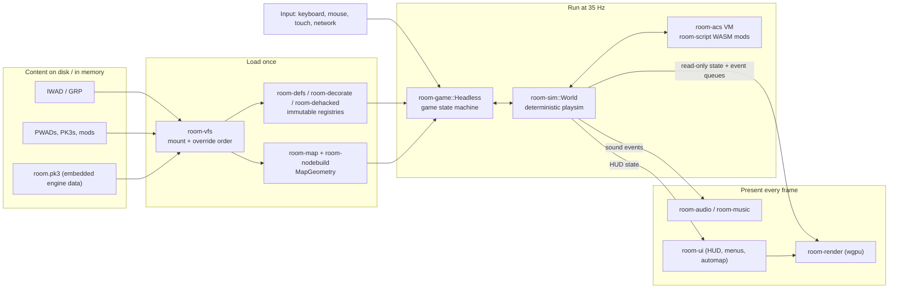

---

## 2. Crate map

The workspace has about 35 crates (`crates/room-*`). They form layers; a
crate may only depend on layers below it (`01-architecture.md` §2).

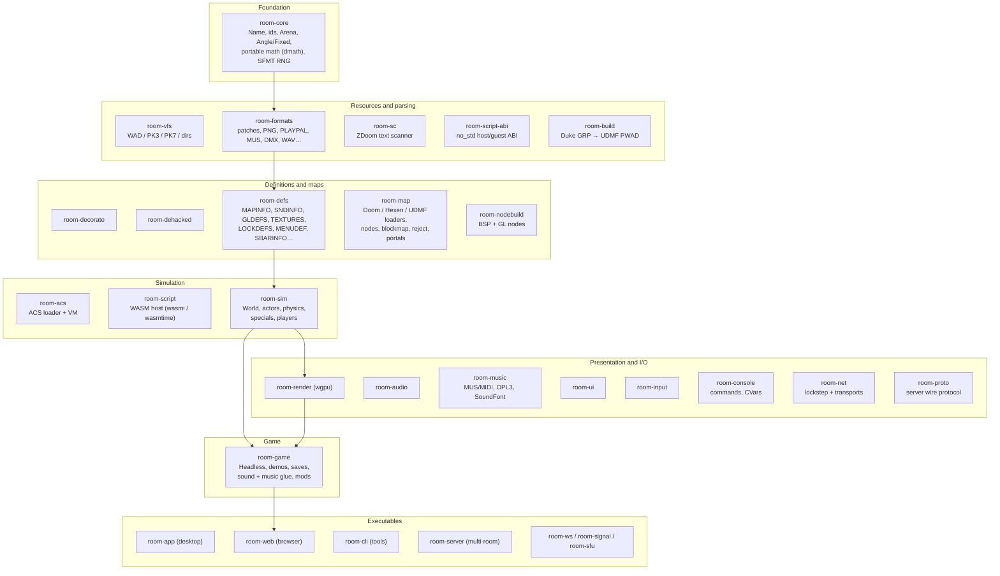

| Crate | One-line job |
|---|---|
| `room-core` | Shared primitives: interned `Name`, typed ids, generational `Arena`, deterministic math (`dmath`), named RNG streams. |
| `room-vfs` | Mounts archives in load order; looks up lumps by name + namespace; last mount wins. |
| `room-formats` | Pure binary parsers with no engine knowledge (graphics, palettes, sounds, music). |
| `room-sc` | The ZDoom-style tokenizer every text-lump parser uses. |
| `room-defs` | Compiles text lumps into immutable registries (`Definitions`). |
| `room-decorate` / `room-dehacked` | DECORATE → class IR; DeHackEd/BEX/MBF21 patches applied to it. |
| `room-map` / `room-nodebuild` | Map loading, validation, fixes, nodes, blockmap, reject, 3D floors, portals, polyobjects. |
| `room-sim` | The playsim: `World`, thinkers, actors, physics, damage, specials, players, ACS integration, WASM mod bridge. |
| `room-acs` | ACS bytecode loader and VM. |
| `room-script` / `-abi` / `-sdk` | WASM runtime (host), shared ABI, guest SDK for Rust mods. |
| `room-render` | wgpu renderer: BSP visibility, scene lists, materials, lights, sprites, models, voxels, sky, post, 2D canvas. |
| `room-audio` / `room-music` | SFX mixer with Doom attenuation; music (MUS/MIDI via OPL3 or SoundFont). |
| `room-ui` | GPU-free 2D draw lists: menus, status bar, HUD, automap, intermission, finale. |
| `room-input` / `room-console` | Device state → `TicCmd`; console, commands, CVars, config. |
| `room-net` / `room-proto` | Peer lockstep and transports; the room-server v2 protocol codecs. |
| `room-game` | Owns a game session: `Headless`, level flow, intermission, hubs, demos, saves, sound/music glue, mod discovery. |
| `room-app` / `room-web` / `room-cli` | Desktop shell (winit + wgpu + cpal), browser shell (wasm-bindgen + WebGPU/WebGL2 + Web Audio), tools. |
| `room-server` | Production multi-room WebSocket server with lobby, admin console, mods, verifier, STUN/TURN. |

---

## 3. From files to a running level

### 3.1 Mounting content (VFS)

`room-vfs` builds a single, ordered view of all archives. Lookups return
the **last** match, so later mounts override earlier ones; "additive" lumps
(DECORATE, SNDINFO, MAPINFO, …) are read in order with `find_all`.

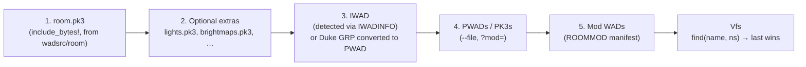

Each lump belongs to a **namespace** (global, sprites, flats, patches,
textures, music, sounds, …) derived from WAD markers (`S_START`/`S_END`) or
PK3 folders (`sprites/`, `flats/`). The binary layout of WAD files, how
namespaces, overrides and lookups work, and how each kind of lump becomes
engine data are described in detail in **§17**.

### 3.2 Building the definitions

`room-game` loads engine data and the shell layers PWAD definitions on top.
DECORATE (engine + PWAD) is parsed into an IR, DeHackEd patches it, and the
result becomes two tables that the sim uses directly:

- `ClassRegistry` — every actor class: defaults, flags, DoomEdNum, parent,
  replacements, state labels.
- `StateTable` — a flat array of all states (`sprite`, `frame`, `tics`,
  `action` + args, `next`), addressed by `StateId`.

Other text lumps compile into `room-defs` registries: `MapInfo`,
`SoundRegistry` (SNDINFO), `TextureRegistry` (TEXTUREx/PNAMES/TEXTURES),
`AnimDefs`, `GlDefs` (lights, brightmaps, skyboxes, shaders), `LockDefs`,
`TerrainDefs`, `DecalDefs`, `KeyConf`, `MenuDef`, `SbarInfo`, `Language`,
`VoxelDefs`, `ModelDefs`, …

The shell hands them to `Headless` through setters (`set_defs`,
`set_mapinfo`, `set_sounds`, `set_lockdefs`, `set_keyconf`, `set_terrain`,
`set_sndseq`, `set_decaldef`, `set_compat_db`, `set_level_fixes`,
`set_acs_libraries`, `set_script_mods`, …).

### 3.3 Loading a map

`room_map::load_map(&vfs, "E1M1")` produces an immutable `MapGeometry`.

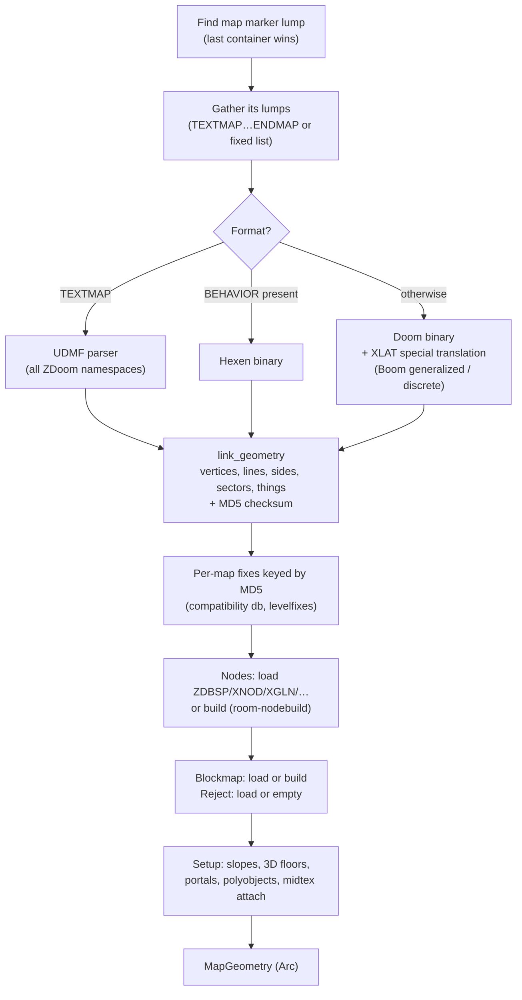

### 3.4 Starting the level

`World::from_map_*` turns the geometry into dynamic state: per-sector planes
(`SectorDynamic`), spawned map things (skill / mode / class filters,
player starts), sector specials, ACS `OPEN` scripts, and the per-level
counters (`LevelState`). `Headless` keeps the world and switches its state
machine to `Level`.

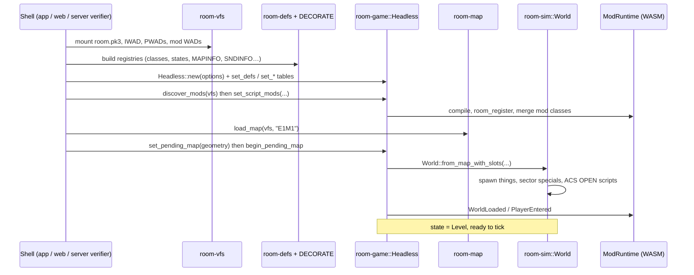

---

## 4. The frame loop

The shells own the clock. On desktop it runs from winit's `RedrawRequested`;
in the browser from `requestAnimationFrame`. Each frame:

1. Read input devices into a sample (keys, mouse deltas, touch sticks).
2. Add the frame time to a **tic accumulator**.
3. While the accumulator holds at least one tic (1/35 s): build a
   `TicCmd`, exchange it (local, or lockstep with peers / the server), call
   `Headless::tick(&cmds)`, then drain the world's output queues into audio,
   renderer and HUD state.
4. Compute `alpha = accumulator / TIC` and render the world interpolated
   between the previous and current tic.

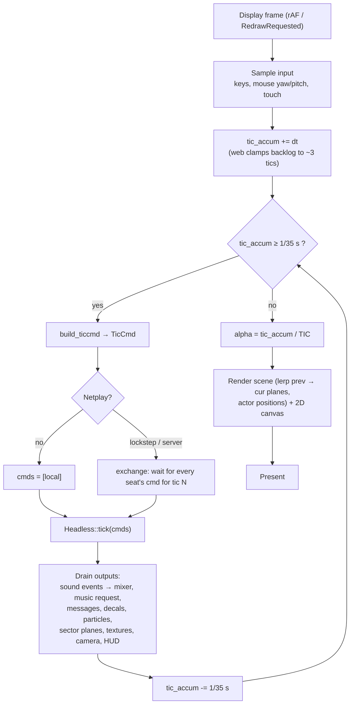

Interpolation: `World::tick` copies each sector's `floor_z`/`ceiling_z` to
`prev_*` before moving anything; the shell lerps between them with `alpha`
so lifts and doors move smoothly at any frame rate. Mouse look is applied
immediately on top of the interpolated view for zero-latency aiming.

> Spec vs code: `01-architecture.md` describes a `room_game::Engine::frame`
> and a `SimView` snapshot type. Today each shell (`room-app/src/main.rs`,
> `room-web/src/play.rs`) runs this loop itself and copies what it needs out
> of `World` after each tic. The rule is unchanged: presentation code reads
> the world, it never mutates sim state.

---

## 5. Inside one tic

### 5.1 `Headless::tick` (game level, ≈ GZDoom `G_Ticker`)

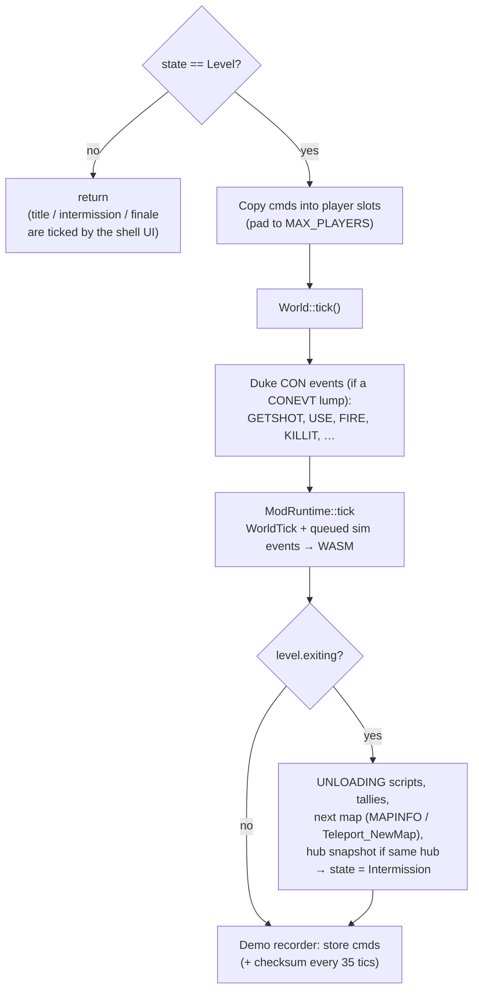

### 5.2 `World::tick` (playsim, ≈ GZDoom `P_Ticker`)

The order is behaviourally significant (vanilla demos and RNG call order
depend on it). `crates/room-sim/src/world.rs`:

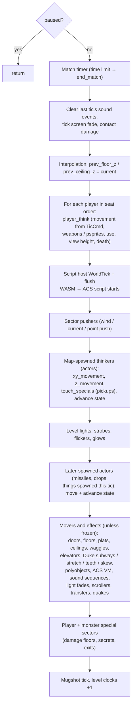

Why actors are split in two passes: Doom runs the thinkers that existed at
map start, then the level-special lights, then everything spawned later.
Keeping that order keeps the shared `P_Random` sequence identical to vanilla
so old demos stay in sync.

### 5.3 The `TicCmd`

All gameplay input is this small struct (per player, per tic):

| Field | Meaning |
|---|---|
| `buttons: u32` | ATTACK, USE, JUMP, CROUCH, SPEED, WEAPONNEXT/PREV, … |
| `yaw`, `pitch`, `roll: i16` | Angle deltas (1/65536 of a turn) |
| `forward_move`, `side_move`, `up_move: i16` | Movement |
| `weapon_select: u8` | Slot request (0 = none) |

Over the network the same data is a fixed 17-byte body (`NetTicCmd`).

---

## 6. Actors and state machines

An **actor** is an entry in a generational `ActorArena` (an `ActorId` is an
index + generation, so a stale reference reads as `None`, like GZDoom's
`TObjPtr`). It has position, velocity, angle, health, flags, a class, and a
current state.

Behaviour is data. A class's states (from DECORATE, DeHackEd or a WASM mod)
form a graph in the `StateTable`. Each tic `advance_actor_state` decrements
`tics`; at zero it follows `next` and calls `set_state`, which runs the
state's **action function** (`A_Chase`, `A_FireBullets`, `A_Explode`, …).
An action may return `Jump(state)`. A state with `tics == 0` chains
immediately; `tics == -1` holds forever (a corpse, unless nightmare respawn).

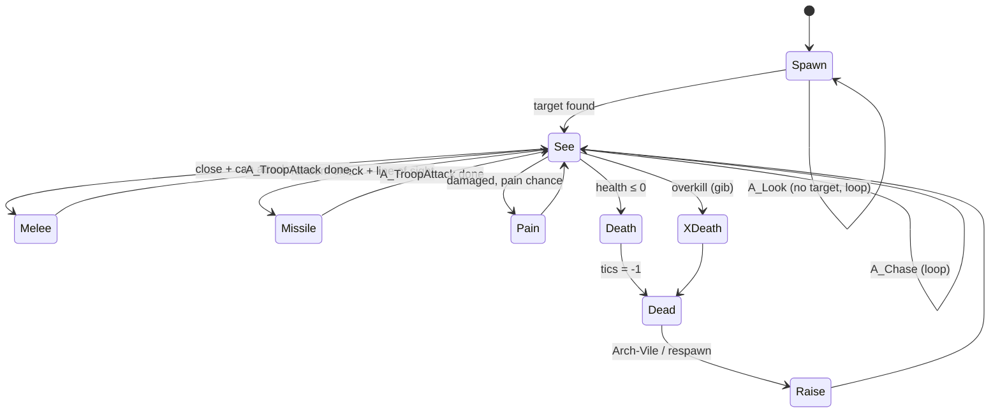

Main actor systems in `room-sim`:

| Module | What it does |
|---|---|
| `physics.rs` | `check_position`, `try_move`, `xy_movement` (sliding, bouncing, friction), `z_movement` (gravity, floating, landing), blockmap collision, dropoffs, step height. A fixed-point path (`vanilla/`) is used for vanilla demo playback. |
| `action.rs` | The native action-function set (codepointers) called by states. |
| `damage.rs` | `damage_mobj`: armor, damage factors, pain, thrust, infighting, death, drops, kill counts, obituaries. |
| `hitscan.rs` / `sight.rs` | Line attacks / autoaim traces; `check_sight` with reject early-out. |
| `think_player.rs` / `player.rs` | `player_think`: movement from `TicCmd`, view bob, use, weapon switching, psprites, death camera. |
| `pickup.rs` / `inventory.rs` | Touching items, inventory bags, `give` / `take`. |
| `class.rs` / `state.rs` | Class registry and state table built from DECORATE IR. |

---

## 7. World interaction: specials and ACS

**Line and sector specials** are numbered actions with up to five integer
arguments (Hexen semantics). Doom/Boom maps are translated to Hexen-style
specials at load (XLAT). A special fires when a line is crossed, used, shot
or bumped (the activation type must match), or when an actor enters a
special sector.

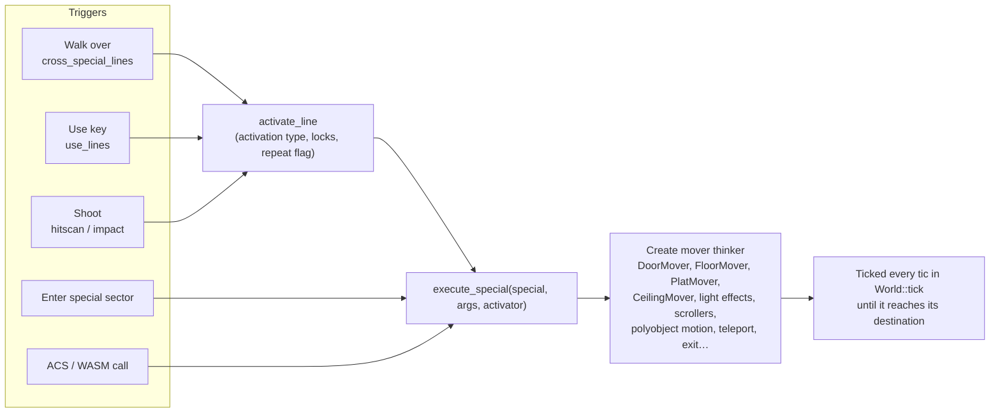

**ACS** (`room-acs`): `BEHAVIOR` lumps and `LOADACS` libraries are loaded at
map start; scripts (`OPEN`, `ENTER`, `RETURN`, `DEATH`, `RESPAWN`,
`UNLOADING`, numbered/named) run on a bytecode VM ticked inside
`World::tick`. They can wait on tics, tags or polyobjects, call any special,
print HUD messages, change textures, music, fog, cameras, etc. Map/world/
global variables live in `World` (`world.acs`) and survive hub travel.

---

## 8. WebAssembly mods

Mods replace ZScript. A mod is a WAD with a `ROOMMOD` manifest lump (or a
PK3 with `room.toml`) plus one or more `.wasm` modules. Any language that
targets `wasm32-unknown-unknown` works; there is a Rust SDK
(`room-script-sdk`) and an AssemblyScript API (`room-web/as/room.ts`).

How it runs today (`room-sim/src/script_mods.rs`, `room-script`):

- **Validation**: one exported memory, imports only from module `"room"`,
  required exports (`room_abi_version`, `room_alloc`, `room_register`,
  `room_init`, `room_dispatch`, …). Threads, memory64, relaxed SIMD are
  rejected.
- **Registration**: `room_register` declares classes (properties, flags,
  `replaces`) and event handlers; mod classes are merged into the session's
  `ClassRegistry`/`StateTable`, so map things can spawn them.
- **Backend**: `wasmi` (interpreter, deterministic, also runs inside the
  browser's wasm); `wasmtime` behind a feature on desktop. Every call has a
  **fuel budget**; a trap or exhausted fuel disables that module and logs
  it, the game keeps running.
- **Execution**: after each `World::tick`, `ModRuntime` *borrows the whole
  world* (moved into a shared cell, no `unsafe`), dispatches `WorldTick`
  and the events the sim queued during the tic, then gives the world back.

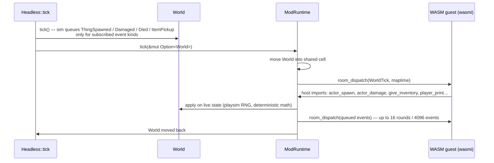

Determinism rules for mods: use the playsim RNG (`rng_range`) and `math_*`
imports, never host time or randomness, or multiplayer rooms desync. Not yet
implemented: module memory in save games, UI-scope modules, per-actor
virtual overrides (`12-wasm-scripting.md` §15).

The full mechanics — validation, backends, the ABI and every host import,
registration, event payloads, world lending, failure handling and the Rust
and AssemblyScript guest SDKs — are described in **§18**.

---

## 9. What the sim emits

The sim never calls the renderer or audio. It fills queues on `World`; the
shell drains them after each tic.

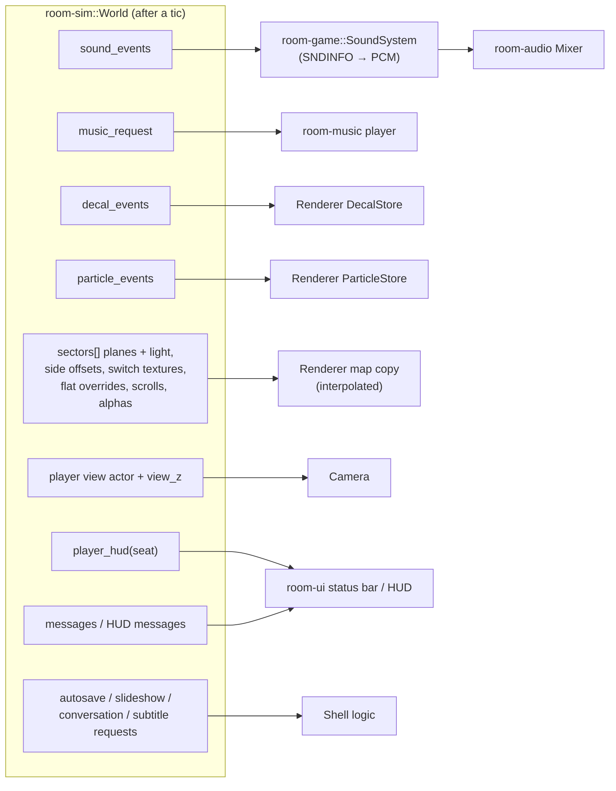

---

## 10. Rendering

`room-render` is wgpu-only (Vulkan / Metal / DX12 natively, WebGPU or WebGL2
in the browser) with WGSL shaders validated at build time. Two tiers share
one code path: **Full** and **Downlevel** (`GpuTier`, chosen from device
capabilities).

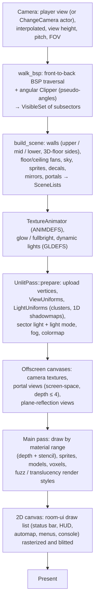

Key pieces:

- **Materials** (`materials.rs`, `texture.rs`): PLAYPAL-expanded RGBA uploads
  of patches/flats/composite textures, nearest + repeat sampling for the
  classic look, brightmaps, hi-res replacements.
- **Lighting**: Doom light diminishing modes in the shader (`LightMode`),
  sector colour and fog, `extralight`, fixed colormaps (invulnerability).
  Dynamic lights use clustered assignment (`CLUSTER_X/Y/Z`) and baked 1D
  shadowmaps against wall occluders. Baked `LIGHTMAP` lumps are supported.
- **Sprites, models, voxels**: 8/16-rotation sprite selection with mirroring
  and render styles; MD2/MD3/OBJ/IQM (GPU skinning)/UE1 models via MODELDEF;
  KVX voxels meshed at load (VOXELDEF).
- **Sky**: cylinder sky (single/double, scrolling, ACS overrides), GLDEFS
  cubemap skyboxes, Duke composed multi-tile skies.
- **Library passes** used by the offscreen/golden tests and available to
  shells: bloom, SSAO, tonemap/palette quantize (`PostPass`), instanced
  particles, lightmaps, skinned models, GLSL → WGSL for GLDEFS shaders.
- **Offscreen rendering** (`offscreen.rs`, `capture.rs`) renders any view to
  PNG with no window — the basis of the golden-image tests.

> Portals and mirrors: each visible portal view is drawn into a
> full-resolution target every frame and sampled in screen space by the
> portal surface (`room-render/src/portal_view.rs`, `13-renderer.md` §6).

---

## 11. Audio and music

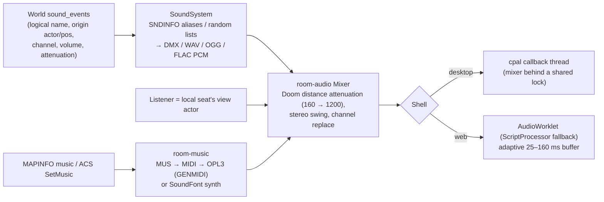

---

## 12. UI

`room-ui` produces a GPU-free `UiDrawList` (fills, patches, text, lines) in a
320×200 virtual space; the shell scales it (letterboxed) and the renderer's
canvas backend rasterizes it. It provides the Doom status bar (`STBAR`
layout, mugshot, ammo, keys), SBARINFO bars, fullscreen HUD, palette flashes
(`screen_blend`), automap, menus (built-in list menus + MENUDEF runtime),
intermission tallies, finale text and the title screen. `room-console`
handles the console, commands (`map`, cheats, `exec`), CVars and config.

---

## 13. Determinism, checksums, demos, saves

Determinism is a hard rule for everything that runs inside a tic
(`02-conventions.md`):

- no `HashMap` iteration in sim code (`BTreeMap` / `Vec` instead),
- no `std` transcendental floats — `room_core::dmath` provides portable
  `sin`/`cos`/`atan2`/`sqrt`,
- no wall clock, no threads, no host randomness,
- RNG = named SFMT-607 streams (GZDoom `FRandom`) plus vanilla `rndtable`
  for vanilla demos; UI effects use a separate `UiRng`.

`World::checksum()` hashes level clocks, every sector's plane heights and
light, every actor's class / position / health / tics, and RNG state. It is
the single tool behind:

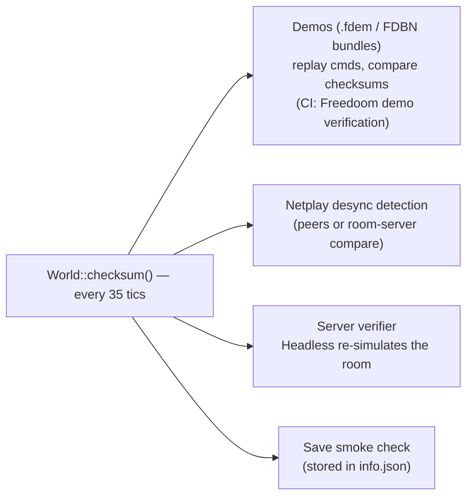

- **Demos** (`room-game/src/demo.rs`): `DemoRecorder` stores each tic's
  cmds and a checksum every 35 tics; `DemoPlayer::verify` replays and
  compares. Vanilla `.lmp` playback uses the fixed-point/vanilla-RNG paths.
- **Saves** (`room-game/src/save.rs`): `.fsave` is a ZIP with `info.json`
  (format version, map, skill, time, checksum) and `world.bin` (`FWLD`
  magic: players, armor, weapons, inventory, sectors, …), optional
  `scripts.bin`. Hubs keep in-memory snapshots (ACS map vars, plane heights)
  when travelling between maps of one cluster.

---

## 14. Multiplayer

All multiplayer is **deterministic lockstep**: every client runs the full
simulation; only `TicCmd`s travel. The sim advances tic *N* only when the
commands of every seat for tic *N* are known.

### 14.1 Peer lockstep (desktop, `room-net`)

`LockstepSession` buffers local input with a delay, broadcasts
`TimedCmd {tic, peer, cmd}` to peers and advances when all are present.
Transports: UDP (default), TCP mesh, TCP relay server (`tcp-server`),
optional Noise_XX encryption, WebRTC (feature), in-process loopback for
tests. A lobby (Hello / Welcome / Start / Ready) checks engine version, ABI
and content fingerprint before tic 0.

### 14.2 Browser rooms (`room-server`, protocol v2)

The server is the arbitrator and the only sender of tic frames. Clients send
only their own input; the server stamps the seat from the connection (no
forging), clocks frames at 35 Hz, and fills a stalled seat after a short
grace (`--stall-fill-ms`: repeat last cmd 3 tics, then neutral).

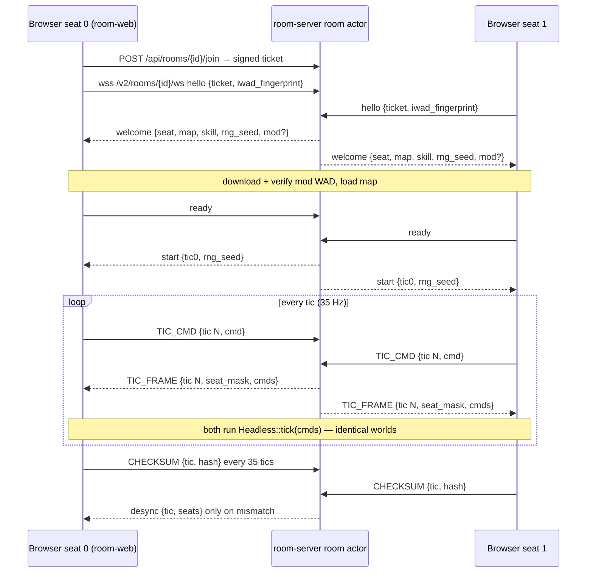

Each room is one tokio task (no locks on the hot path) behind a bounded
channel. The server keeps the frame log of each match, so **spectators**
join late, receive `TIC_BATCH` from tic 0, fast-forward the simulation and
then watch live. The optional **verifier** runs `Headless` on the server
from the same inputs. Around it: public lobby, admin console (MFA, bans,
kick/mute, mod allow-list, drain), leaderboard, STUN/TURN and an optional
SFU for voice. Details in `22-room-server.md`.

---

## 15. Platform shells

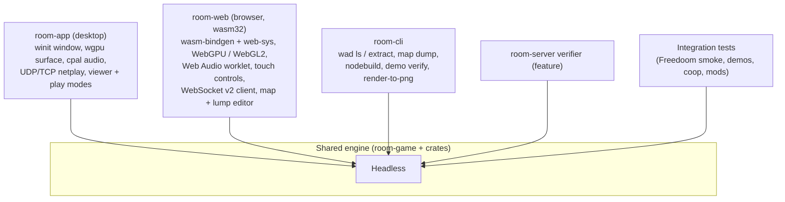

The browser build is the same engine compiled to `wasm32-unknown-unknown`.
WASM mods run inside it through `wasmi` (wasm-in-wasm). The web editor runs
the real engine in its 3D pane and can hot-swap mods and edited textures
into a running play test.

---

## 16. Duke Nukem 3D (Build engine)

Build content goes through the same pipeline as Doom content: `room-build`
converts the GRP into an in-memory UDMF PWAD, which is mounted like any
other archive.

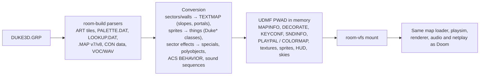

There is no CON VM: CON files are read for data (actions, strengths, sounds,
quotes) and a subset of events; AI is mapped to Doom codepointers. See
`23-build-engine.md`.

---

## 17. Deep dive: WAD files and the virtual filesystem

Everything the engine loads — IWADs, PWADs, PK3s, the embedded `room.pk3`,
mod WADs, the converted Duke PWAD — goes through `room-vfs`. It turns a
list of containers into one flat, ordered table of **lumps** (named blobs)
with fast name lookup. It has no engine knowledge: it never parses a lump's
contents. Code: `crates/room-vfs/src/` (`wad.rs`, `archive.rs`, `vfs.rs`,
`namespace.rs`, `iwad.rs`, `autoload.rs`, `write.rs`).

### 17.1 The WAD binary format

A WAD is a 12-byte header, the lump data, and a directory of 16-byte
entries (usually at the end of the file). All integers are little-endian.

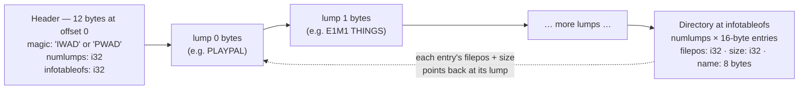

| Field | Size | Meaning |
|---|---|---|
| `magic` | 4 | `IWAD` (main game data) or `PWAD` (patch). Room treats both the same way; only load order matters. |
| `numlumps` | i32 | Number of directory entries. |
| `infotableofs` | i32 | Byte offset of the directory. |
| entry `filepos` | i32 | Offset of the lump's bytes. |
| entry `size` | i32 | Lump length. Zero-size lumps are **markers** (`E1M1`, `S_START`, …). |
| entry `name` | 8 | ASCII, NUL-padded, case-insensitive. |

`parse_wad` is written for untrusted input (every parser must be fuzzable
and never panic):

- files shorter than 12 bytes, a bad magic, a negative lump count or
  directory offset, or a directory past the end of file → `VfsError::Parse`;
- negative `filepos` / `size` are clamped to 0;
- a lump that runs past the end of the file is **truncated** to what exists
  and a mount warning is recorded (`Vfs::warnings()`), as GZDoom does;
- names are read up to the first NUL and upper-cased into a `ShortName`
  (8 bytes compared as one `u64`, so lookups are a single integer compare).

Parsing reads only the header and directory. Lump bytes are read later, on
demand (§17.5).

### 17.2 Container kinds and detection

`VfsBuilder::mount_path` / `mount_memory` sniff the bytes first, then fall
back to the file extension:

| Kind | Detected by | How entries become lumps |
|---|---|---|
| WAD | `IWAD` / `PWAD` magic, or `.wad` | Directory entries; namespaces from marker ranges (§17.3). |
| ZIP / PK3 | `PK\x03\x04`, or `.pk3 .ipk3 .zip .pke` | One lump per file; namespace from the top folder. Deflate, bzip2 and LZMA, all pure Rust. Entries are decompressed at mount. |
| 7z / PK7 | `7z\xBC\xAF'\x1C`, or `.pk7 .ipk7 .7z` | Like PK3 (behind the `7z` feature). |
| Directory | a folder path | Like PK3; files are read from disk on demand (handy for development: `wadsrc/room`, `lights/`). |
| Loose file | anything else | One global lump named after the file stem (e.g. a `.deh` patch). |

Each mounted container gets a `ContainerId`, a `ContainerKind` and the MD5
of its bytes (`Vfs::container_md5`; zeros for directories).

**Nested WADs.** A `.wad` at the root of a PK3 is mounted as its own
container right after the PK3, so its lumps override the PK3's. A WAD under
`maps/` is kept as a plain lump and not mounted.

### 17.3 Namespaces

Short names alone are ambiguous (a sprite and a flat may share a name), so
each lump carries a `Namespace`.

**In WADs**, marker pairs open and close a range:

| Start marker | End marker | Namespace |
|---|---|---|
| `S_START`, `SS_START` | `S_END`, `SS_END` | Sprites |
| `F_START`, `FF_START` | `F_END`, `FF_END` | Flats |
| `P_START`, `PP_START` | `P_END`, `PP_END` | Patches |
| `TX_START` | `TX_END` | NewTextures (whole textures as single images) |
| `C_START` | `C_END` | Colormaps |
| `A_START` | `A_END` | ACS libraries |
| `V_START` | `V_END` | Voxels |
| `HI_START` | `HI_END` | HiRes replacements |

Everything outside a range is `Global`. The marker lumps themselves are
global, zero-size and flagged `MARKER`. Old PWADs are often sloppy, so the
rules follow GZDoom: an `END` without its `START` is ignored, a missing
`END` runs to the end of the file, and the **flat hack** applies — if a WAD
has `F_END`/`FF_END` but no start marker, every 4096-byte global lump before
it is flagged `MAYBE_FLAT` (64×64 flats in PWADs that forgot `FF_START`).

**In PK3s and directories**, the first folder decides:

| Folder | Namespace | Folder | Namespace |
|---|---|---|---|
| `sprites/` | Sprites | `sounds/` | Sounds |
| `flats/` | Flats | `music/` | Music |
| `textures/` | NewTextures | `graphics/` | Graphics |
| `patches/` | Patches | `fonts/` | Fonts |
| `colormaps/` | Colormaps | `acs/` | Acs |
| `voxels/` | Voxels | `models/` | Models |
| `hires/` | HiRes | `shaders/` | Shaders |
| `brightmaps/` | Brightmaps | `materials/` | Materials |
| `maps/` | Maps | `voices/`, `skins/` | Voices, Skins |

Path rules (`archive.rs`):

- Paths are normalised to lower case with `/`.
- A file at the root (`decorate.txt`) or in a namespace folder
  (`sprites/trooa1.png`) gets a short name from its stem (`DECORATE`,
  `TROOA1`) and can be found by short name **and** full path.
- A file in any other folder (`actors/doom/imp.txt`) is `FULLPATH`-only:
  reachable with `find_full`, typically through DECORATE `#include`.
- If every file sits under one shared non-namespace root folder (a zip of a
  folder), that folder is stripped.
- **Filters**: `filter/<name>/…` entries are mounted only when `<name>` is
  active, with the prefix removed. Active names come from the detected IWAD
  record: `game-doom`, then each prefix of its `Autoname`
  (`doom`, `doom.freedoom`, `doom.freedoom.phase2`). This lets one PK3 ship
  per-game variants.

### 17.4 Load order, indexing and lookup

`VfsBuilder::build()` gives every lump a `LumpId` equal to its position in
mount order, then builds two indexes:

- `by_short: IndexMap<(Namespace, u64), SmallVec<[LumpId; 2]>>` — every
  lump with that short name in that namespace, in load order;
- `by_full: HashMap<String, LumpId>` — full path → lump (also registered
  without its extension).

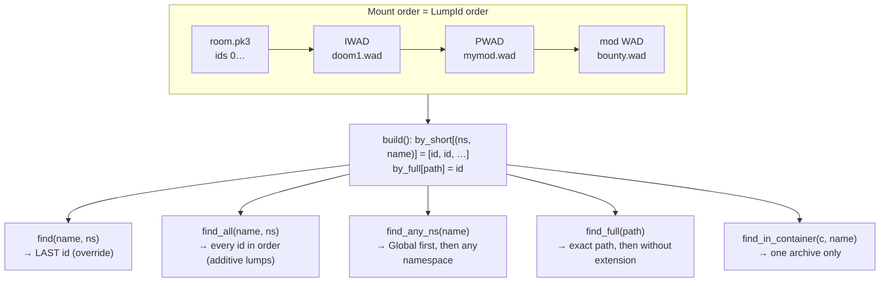

This one rule — **the last mount wins** — is how PWADs replace textures,
sounds, sprites, maps and single-instance lumps like `PLAYPAL`, while
"additive" lumps (DECORATE, SNDINFO, MAPINFO, LANGUAGE, KEYCONF, GLDEFS,
TEXTURES, …) are read with `find_all` and **concatenated in load order**
(`DefinitionsBuilder::read_all_text`). MAPINFO is special-cased like GZDoom:
per archive, `ZMAPINFO` is used instead of `MAPINFO` when both exist.

Typical mount order, by shell:

| Shell | Order |
|---|---|
| Desktop `room-app` | `room.pk3` (embedded) → optional `lights.pk3` / `brightmaps.pk3` / … → `--iwad` (or a Duke GRP converted to a PWAD) → each `--file` |
| Browser `room-web` | `room.pk3` → IWAD bytes (`roomStartIwad`) → PWADs added with `roomAddPwad` / `?mod=` → in rooms, the server's mod WAD after its fingerprint check |
| Server verifier | same as the room's clients: IWAD → mod catalog bytes |

### 17.5 Reading lump bytes

```mermaid
sequenceDiagram
  participant C as Caller (defs, map loader, renderer…)
  participant V as Vfs
  participant L as LRU cache (256 MiB)
  participant S as ContainerSource
  C->>V: read(LumpId)
  V->>L: get(id)
  alt cached
    L-->>C: Bytes (cheap clone)
  else not cached
    V->>S: WAD: read_range(filepos, size)<br/>PK3: already-inflated bytes<br/>directory: read the file
    S-->>V: bytes
    V->>L: insert (evicts least recently used)
    V-->>C: Bytes
  end
```

- `ContainerSource` is a small trait (`len`, `read_at`) with two
  implementations: `MemorySource` (embedded data, browser, tests) and
  `FileSource` (positioned reads). Mounting a path currently loads the file
  into memory, which is also what the browser does.
- Results are `bytes::Bytes`, so the cache and every reader share one buffer
  without copying.

### 17.6 IWAD detection

The embedded `room.pk3` contains an `IWADINFO` lump (GZDoom syntax):

```
IWad
{
    Name = "Freedoom: Phase 2"
    Autoname = "doom.freedoom.phase2"
    Game = "Doom"
    MustContain = "MAP01", "MAP02", "PLAYPAL", "TITLEPIC"
}
```

`detect_iwad(&vfs, &info)` returns the first record whose `MustContain`
names are all present (`find_any_ns`). The match gives the game family and
the filter names of §17.3. `collect_autoload_paths` then lists the files to
mount after the IWAD from the config `[*.Autoload]` sections and `autoload/`
folders (`global`, `<game>`, `<game>.<family>`, `<autoname>`).

`room.pk3` itself is built at compile time: `crates/room-game/build.rs` zips
`wadsrc/room/` (DECORATE actors, MAPINFO, SNDINFO, IWADINFO, compat
databases, …) into `OUT_DIR/room.pk3`, and `include_bytes!` embeds it in
every binary, including the wasm build.

### 17.7 From lumps to engine data

`room-vfs` only stores bytes. Other crates find and decode them:

| Lump(s) | Found by | Decoded by → result |
|---|---|---|
| Map marker (`E1M1`, `MAP01`) + following lumps | `find` on the marker, then the lumps **after it in the same container** until the next marker (`THINGS`, `LINEDEFS`, `SIDEDEFS`, `VERTEXES`, `SEGS`, `SSECTORS`, `NODES`, `SECTORS`, `REJECT`, `BLOCKMAP`, `BEHAVIOR`, or `TEXTMAP`…`ENDMAP`) | `room-map::load_map` → `MapGeometry` |
| `PLAYPAL`, `COLORMAP`, `TRANMAP` | `find` (last wins) | `room-formats` → palettes, light tables, translucency table |
| `PNAMES` + `TEXTURE1` / `TEXTURE2` | `find` | `parse_pnames` / `parse_texturex` → composite wall textures made of patches |
| `TEXTURES` (text) | `find_all` | overrides TEXTUREx definitions by name |
| Wall / flat picture | renderer `MaterialCatalog::source_image`: a `TX_START` lump, else the TEXTUREx composite, else a patch / flat / sprite lump with that name | `decode_image` sniffs PNG, JPEG, BMP, PCX, TGA, else Doom patch (columns of posts; unwritten pixels get alpha 0) → RGBA upload through PLAYPAL |
| Sprites `TROOA1`, `TROOA2A8` | Sprites namespace; name = 4-letter sprite + frame letter + rotation digit (0 = all angles, 1–8 = view angles); a second frame/rotation pair means the same picture mirrored | `sprite_lump_candidates_rot` + `decode_image` |
| Sounds | SNDINFO logical name → lump name, then `Sounds` namespace → `Global` → any | `decode_sound` sniffs VOC, WAV, Ogg, FLAC, MP3, else DMX → PCM resampled to the mixer rate |
| Music `D_E1M1`, MAPINFO `music` | `find` | MUS → MIDI (`mus_to_midi`) → OPL3 or SoundFont; streams decoded directly |
| Text definitions | `find_all` (additive) or last | `room-defs` / `room-decorate` / `room-dehacked` registries (§3.2) |
| `BEHAVIOR`, `LOADACS` libraries | map lumps / `A_START` namespace | `room-acs` |
| `ROOMMOD` / `room.toml` | every lump with that name | mod discovery (§18.1) |

### 17.8 Writing WADs

`WadWriter` (`room-vfs/src/write.rs`) builds WADs in memory:
`WadWriter::pwad().marker("S_START").add("TROOA1", bytes).marker("S_END").finish()`.
It is used by:

- tests and `room-testkit` (fixture maps and resources built in code);
- the Duke converter (`room_build::grp_to_wad`), whose output is mounted
  like any PWAD;
- mod packaging (`scripts/room-server.sh mods`): `ROOMMOD` manifest +
  one lump per module + optional `S_*` source lump;
- the web editor's *Export WAD*: maps plus override lumps for edited
  textures, flats, patches and sprites (`TX_` / `FF_` / `PP_` / `SS_`),
  and mod modules.

### 17.9 Fingerprints

Three different hashes identify content:

| Hash | Over | Used for |
|---|---|---|
| Container MD5 | the whole container's bytes | load-order identity, tooling |
| Map MD5 | the map's lumps (as GZDoom computes it) | per-map compatibility flags and level fixes |
| `content_fingerprint` (FNV-1a 64 xor length, `room-proto`) | IWAD / mod WAD bytes | multiplayer: every seat must load identical content, the server rejects a mismatch |

---

## 18. Deep dive: WebAssembly scripting

This section follows a mod from its files to the moment it changes the game.
Code: `crates/room-script-abi` (shared ABI), `crates/room-script` (host
runtime), `crates/room-sim/src/script_mods.rs` (game bridge),
`crates/room-game/src/mods.rs` (discovery), `crates/room-script-sdk` (Rust
guest SDK), `crates/room-web/as/` (AssemblyScript guest API).

```mermaid
flowchart LR
  subgraph Pack["Mod WAD / PK3"]
    MAN["ROOMMOD lump<br/>or room.toml"]
    WASM["module lump<br/>(e.g. SURVIVAL)"]
    SRC["optional S_* source lump"]
  end
  Pack --> DISC["room-game::discover_mods<br/>→ Vec of ModSource"]
  DISC --> RT["room-sim::ModRuntime::new<br/>validate, instantiate (wasmi),<br/>register, init"]
  RT --> MERGE["merge_classes<br/>→ session ClassRegistry / StateTable"]
  MERGE --> HL["Headless<br/>begin_map → tick → end_map"]
  HL --> W["World<br/>(lent to the mod between tics)"]
```

### 18.1 Packaging and discovery

A mod declares itself with a manifest. In a WAD it is the `ROOMMOD` lump;
in a PK3 or folder it is `room.toml` at the root. Example
(`mods/doom1-bounty/room.toml`):

```toml
[mod]
id = "room.example.doom1-bounty"
name = "Bounty Hunter"
version = "0.1.0"
abi = 1

[[module]]
file = "BOUNTY"        # lump name in a WAD, or a path in a PK3
scope = "play"         # play | ui
name = "bounty"
source = "S_BOUNTY"    # optional: source shipped for the web editor
```

`room_script::manifest::Manifest::parse` accepts the subset of TOML the
manifest uses (`[mod]`, `[[module]]`, string / integer / bool values) and
ignores unknown keys. An `abi` other than the host's `ABI_VERSION` (1) is
an error.

`room_game::discover_mods(&vfs)`:

1. Visits every lump named `ROOMMOD` or with path `room.toml`, in load order.
2. Resolves each module's `file`: first a lump with that path or short name
   **in the same container**, then `find_full(path)`, then any namespace.
3. Reads the bytes into a `ModSource { mod_id, name, scope, bytes }`.
4. If a later manifest has the same `id`, its module list **replaces** the
   earlier one (a PWAD can patch a mod), keeping the first position.
5. Returns the sources plus a list of readable errors (bad manifest, missing
   module) for the shell to print.

The shells call it once the VFS is built and pass the result to
`Headless::set_script_mods`.

### 18.2 Validation

Before compiling, `room_script::validate_module` walks the binary with
`wasmparser` and rejects anything outside the sandbox contract:

| Check | Rule |
|---|---|
| Module kind | Core modules only; components are rejected. |
| Memory | Exactly one memory, exported as `memory`; not `memory64`, not `shared`; at most `max_memory_pages` (default 4096 pages = 256 MiB). |
| Imports | Only from module `"room"` (no WASI, no `env`). AssemblyScript's `Math.random` would import `env.seed` and is rejected with a hint. |
| Exports | `room_abi_version`, `room_alloc`, `room_free`, `room_register`, `room_init`, `room_dispatch` must all exist. |

### 18.3 Backends, fuel and limits

`WasmBackend` / `WasmInstance` abstract the engine:

| Backend | Where | Configuration |
|---|---|---|
| `wasmi` (default, used by `ModRuntime`) | desktop, browser (wasm inside wasm), server, tests | interpreter, `consume_fuel(true)`, `StoreLimits` caps memory growth |
| `wasmtime` (feature) | desktop | Cranelift JIT, `consume_fuel(true)`, `cranelift_nan_canonicalization(true)` so float NaNs are bit-identical across CPUs |

Every top-level host→guest call gets a `Budget` from `ModuleConfig`:
**50 million fuel units** and a **nesting depth of 64**. The remaining fuel
is read back after the call. Running out returns `Trap::OutOfFuel`; going
too deep returns `Trap::CallDepth`. An infinite loop in a mod therefore
stops at the budget instead of freezing the game.

### 18.4 ABI conventions

| Topic | Rule |
|---|---|
| Values | `i32`, `i64`, `f64` (and `f32`) as plain WASM values; all memory layouts little-endian. |
| Pointers | `u32` offsets into the guest's own `memory`. The host never hands out host pointers. |
| Strings in | `(ptr, len)` UTF-8; the host reads at most 4096 bytes and is lossy on bad UTF-8. |
| Strings out | `(buf, cap) -> len`: the host writes up to `cap` bytes and returns the full length (call again with a bigger buffer if needed). |
| Arrays out | `(out, cap) -> total` (e.g. `actor_iter_class` fills `ActorRef`s). |
| `ActorRef` | `u64` = slot index \| generation << 32; 0 = null. A destroyed actor's ref is simply dead, never reused for another actor. |
| `ClassRef` | `ClassId + 1`; 0 = not found. |
| `NameRef` | interned name id; 0 = empty. |
| Out-of-bounds | Host reads/writes outside guest memory return empty / false instead of trapping the host. Non-finite `f64` arguments are treated as 0. |

Required guest exports:

| Export | Signature | Called |
|---|---|---|
| `room_abi_version` | `() -> i32` | once at load; must return 1 |
| `room_alloc` | `(size, align) -> ptr` | by the host for its scratch buffer |
| `room_free` | `(ptr, size, align)` | reserved |
| `room_register` | `() -> i32` | once; declares classes and handlers (0 = ok) |
| `room_init` | `(session_kind) -> i32` | new game (0), load game (1), hot reload (2) |
| `room_dispatch` | `(callback_id, payload_ptr, payload_len) -> i64` | for every event |
| `room_on_save` / `room_on_load` | optional | save-game hooks (reserved) |

### 18.5 Host imports

All imports live in module `"room"`. There are three groups:

**Common** (`room-script-abi/api/common.ron`): `log`, `level_time`,
`actor_exists`, `player_count`, `name_intern`, `class_find`, `acs_execute`.

**Registration** (`api/reg.ron`, valid during `room_register`):
`reg_class_begin(name, parent, replaces, doomednum, flags) -> ClassRef`,
`reg_class_property_i32`, `reg_class_property_str`, `reg_class_flag`,
`reg_class_end`, `reg_state_label`, `reg_state`, `reg_class_virtual`,
`reg_event_handler(name, order, flags, mask_lo, mask_hi, callback_base)`,
`reg_thinker_class`, `reg_static_function`. The `.ron` files are the IDL
from which `room-abi-gen` can generate bindings.

**Game** (`room-script/src/game.rs`, 44 functions). They are declared once
in a single macro table (`GameFn`), and each backend links the whole table
generically from it, so adding an import is one line plus its handler.

| Area | Imports |
|---|---|
| Game / level | `game_skill`, `level_mapname`, `level_stat`, `level_things`, `level_exit`, `level_set_music`, `game_get_rule`, `game_set_rule`, `game_end_match` |
| Math / RNG | `math_sin`, `math_cos`, `math_atan2`, `math_sqrt` (deterministic `dmath`), `rng_range` (playsim RNG) |
| Players | `player_actor`, `player_get_i32`, `player_print` (everyone or one seat) |
| Classes | `actor_class`, `class_name`, `class_is_descendant` |
| Actor queries | `actor_pos`, `actor_vel`, `actor_angle`, `actor_get_i32` / `_f64` / `_ref`, `actor_iter_class`, `actor_iter_radius`, `actor_check_sight`, `actor_distance`, `actor_count_inv`, `point_floor_z`, `point_ceiling_z` |
| Actor changes | `actor_spawn` (telefog / position check / friendly flags), `actor_destroy`, `actor_set_i32` / `_f64` / `_ref`, `actor_set_pos`, `actor_set_vel`, `actor_set_angle`, `actor_damage`, `actor_give_inventory`, `actor_take_inventory`, `actor_set_state`, `actor_start_sound` |

Selector constants (which property, which rule, which flag) are shared in
`room-script-abi` (`game::actor_i32`, `game::rule`, `class_prop`,
`event_mask`, …) so host and guests can't drift apart.

On the host side an import call goes through the `GameBridge` trait:

```mermaid
sequenceDiagram
  participant G as Guest code
  participant L as wasmi linker (func_new per GameFn)
  participant B as WorldBridge (room-sim)
  participant W as World (inside the shared cell)
  G->>L: actor_spawn(classRef, x, y, z, angle, flags)
  L->>L: convert params to Val, wrap guest memory as GuestMemory
  L->>B: GameBridge::call(GameFn::ActorSpawn, args, mem)
  B->>W: lock cell, serve(world, f, args, mem)
  W-->>B: new ActorId
  B-->>L: Some(Val::I64(actor_ref))
  L-->>G: result coerced to the declared type (zero if None)
```

### 18.6 Load and registration

`ModRuntime::new(sources, classes)` runs once per new game:

```mermaid
sequenceDiagram
  participant RT as ModRuntime::new
  participant BK as WasmiBackend
  participant M as Module instance
  participant REG as RegistrationSession
  loop each play-scope ModSource (ui modules are skipped and logged)
    RT->>BK: compile (validate_module + wasmi::Module)
    RT->>BK: instantiate with HostLinker (closures over the world cell)
    RT->>M: room_abi_version() — must be 1
    RT->>M: room_register()
    M->>REG: reg_event_handler(…), reg_class_begin / property / flag / end
    RT->>M: room_init(NewGame)
    RT->>M: room_alloc(256, 8) — scratch buffer for event payloads
    RT->>RT: fingerprint ^= FNV(mod_id + wasm bytes)
  end
  RT->>RT: sort handlers by (order, module index), OR their event masks
```

Then `Headless::set_script_mods` calls `merge_classes`, which imports each
registered class into a copy of the session `ClassRegistry`:

- the parent is resolved (default `Actor`), so a mod class inherits the
  parent's DECORATE states and properties, then applies its own property
  and flag overrides;
- a class with `replaces` and no editor number takes the replaced class's
  DoomEdNum, so map things spawn the mod class instead;
- state labels are re-inherited (`StateTable::inherit_labels`).

The merged tables become the session's `classes` / `states`, and every map
of the game uses them. A compile, validation, ABI or registration error
fails `set_script_mods` with a message naming the module; the shell reports
it and the game starts without the mod.

### 18.7 Events and payloads

Handlers subscribe with a 64-bit `event_mask`. The callback id passed to
`room_dispatch` is `callback_base + bit index` (the SDKs use base 1000).
Payloads are written into the module's scratch buffer (≤ 256 bytes):

| Bit | Event | Payload (little-endian) | Raised |
|---|---|---|---|
| 0 | `WorldTick` | `i32 maptime` | after every tic |
| 1 | `WorldThingDied` | `u64 thing, u64 source, u64 0` | an actor dies |
| 3 | `WorldLoaded` | `i32 0, i32 maptime` | map start |
| 4 | `WorldThingSpawned` | `u64 thing` | an actor spawns |
| 5 | `WorldThingDamaged` | `u64 thing, u64 source, u64 inflictor, i32 damage, i32 health` | after armor |
| 6 | `PlayerEntered` | `u64 actor, i32 player+1` | map start, per player |
| 7 | `PlayerDied` | `u64 actor, i32 player+1` | a player body dies |
| 8 | `WorldUnloaded` | — | map end / hot swap |
| 9 | `WorldItemPickup` | `u64 toucher, i32 ClassRef` | an item is picked up |

The sim only records an event when some handler subscribed to it
(`World::script_event_mask`), so unused events cost nothing. At most 4096
events are queued per tic. After the tic, events are dispatched in rounds:
handlers may cause new events (spawning, damaging), which are dispatched in
the next round, up to 16 rounds.

### 18.8 Lending the world

Host imports need `&mut World`, but the world is owned by `Headless`, and
the guest is called from Rust code that also holds the runtime. Room solves
this without `unsafe` and without copying the world:

```mermaid
flowchart LR
  A["Headless.world:<br/>Option&lt;World&gt; = Some"] -- "take()" --> B["ModRuntime cell:<br/>Arc&lt;Mutex&lt;Option&lt;World&gt;&gt;&gt; = Some"]
  B --> C["Guest runs.<br/>Each import locks the cell<br/>and edits the live World"]
  C -- "take() back" --> D["Headless.world = Some<br/>(cell = None)"]
```

`with_world` moves the world into the cell, runs the dispatch, and moves it
back. While the world is out, `Headless` holds `None`, so nothing else can
touch it. The mutex is never contended (everything runs on one thread); it
only proves exclusive access to the compiler. Imports called outside a
dispatch (no world in the cell) return zero values.

Where the runtime hooks into the game:

| Moment | Call | Events |
|---|---|---|
| Map starts | `ModRuntime::begin_map` | sets `World::script_event_mask`, then `WorldLoaded`, `PlayerEntered` × players |
| Every tic, after `World::tick` | `ModRuntime::tick` | queued sim events, `WorldTick`, follow-up rounds |
| Map ends | `ModRuntime::end_map` | `WorldUnloaded`, clears the mask |
| New game | new `ModRuntime` | fresh instances (`room_init(NewGame)`); instances persist across maps of the same game |
| Web editor save during play test | `Headless::hot_swap_script_mods` | old modules get `WorldUnloaded`, new ones `WorldLoaded` / `PlayerEntered`; the level keeps running |

### 18.9 Determinism

Mods run inside the lockstep simulation, so they follow the playsim rules:

- `rng_range` draws from the playsim's named RNG stream `pr_script`, so all
  peers get the same numbers;
- `math_*` use `room_core::dmath`, not the CPU's libm;
- no import exposes time, randomness, files or the network;
- the runtime's fingerprint (FNV of every module's id and bytes, mixed with
  the registration fingerprint) identifies the exact mod set.

In `room-server` rooms, every client downloads the room's mod WAD from
`/api/mods/<name>.wad`, checks its fingerprint and mounts it after the IWAD;
the optional server verifier mounts the same bytes, so checksums agree.

### 18.10 Failures

| Failure | Effect |
|---|---|
| Bad manifest / missing module file | Collected by `discover_mods`, printed by the shell; other mods still load. |
| Validation, ABI mismatch, `room_register` or `room_init` ≠ 0 | `set_script_mods` returns an error naming the module; the game runs without mods. |
| Trap at runtime (`unreachable`/panic, out-of-bounds, out of fuel, depth) | That module is marked failed and skipped from then on; `"[name] disabled: …"` goes to the log and the HUD; the game and other modules continue. |
| `log` at warning level or worse | Also shown as a HUD message. The log keeps at most 512 lines until the shell drains it (`drain_script_log`). |

### 18.11 Writing a mod (guest side)

**Rust** (`room-script-sdk`, `#![no_std]`, optional `alloc`). The SDK wraps
every import in safe functions (`game::spawn`, `game::print`,
`game::random`, the `Actor` handle with `pos()`, `health()`, `give()`, …)
and decodes payloads into an `Event` enum. `export_mod!(T)` generates
`room_register`, `room_init` and `room_dispatch` for a type implementing
`RoomMod`; `room_abi_version` / `room_alloc` / `room_free` come from the SDK
itself (`room_alloc` is a bump allocator over a static 64 KiB buffer, so the
host's scratch never overlaps the guest's own heap).

```rust
#![cfg_attr(target_arch = "wasm32", no_std)]
use room_script_sdk::game::{self, Event, RoomMod, class_prop, event_mask};
use room_script_sdk::{class_find, reg};

#[cfg(target_arch = "wasm32")]
#[panic_handler]
fn panic(_: &core::panic::PanicInfo<'_>) -> ! {
    core::arch::wasm32::unreachable() // a panic becomes a trap → module disabled
}

#[derive(Default)]
struct Hello { kills: i32 }

impl RoomMod for Hello {
    const NAME: &'static str = "Hello";
    const EVENTS: u64 = event_mask::WORLD_LOADED | event_mask::WORLD_THING_DIED;

    fn register(&mut self) {
        // A tougher imp, spawned wherever the map has a DoomImp.
        let imp = class_find("DoomImp");
        let _ = reg::class_begin("ToughImp", imp, imp, -1, 0);
        reg::class_property_i32(class_prop::HEALTH, 120);
        reg::class_end();
    }

    fn on_event(&mut self, ev: Event) {
        match ev {
            Event::Loaded { .. } => game::print(None, "Hello from WASM!"),
            Event::ThingDied { .. } => self.kills += 1,
            _ => {}
        }
    }
}
room_script_sdk::export_mod!(Hello);
```

The mod crate is a standalone `cdylib` built with
`cargo build --target wasm32-unknown-unknown --release` (profile:
`opt-level = "z"`, `lto`, `panic = "abort"`). `export_mod!` keeps one
instance in a `ModCell`, which refuses re-entrant calls instead of creating
aliasing.

**AssemblyScript** (`crates/room-web/as/room.ts`). Imports are declared with
`@external("room", …)`; a `RoomMod` base class has `onLoad`, `onTick`,
`onThingDied`, `onThingDamaged`, `onItemPickup`, … to override; `register(new
MyMod("name"))` installs it. `room_abi.ts` (appended to every module)
implements the lifecycle exports and decodes payloads in a `switch` on
`callback_id - 1000`. Compile with
`asc mod.ts --runtime incremental --use abort=room/roomAbort -O2`
(`node scripts/asc-compile.mjs`), or live in the web editor's *Scripts* tab.

**WAT** is used for small test modules (`crates/room-script/testdata/*.wat`).

**Packaging**: `./scripts/room-server.sh mods` builds every `mods/<dir>`
(Rust crate or `<module>.ts`) and writes `<name>.wad` with the `ROOMMOD`
lump, one lump per module and the optional source lump (§17.8).

### 18.12 Two script hosts

`room-sim` contains two hosts that share `room-script`:

- **`ModRuntime`** (`script_mods.rs`) — the game-control mods described
  above, owned by `Headless`, run after each tic.
- **`ScriptHost`** (`script_host.rs`, `World::scripts`) — the earlier M11
  host, used inside `World::tick` for `WorldTick` handlers and WASM → ACS
  script starts, plus UI ticks, static-function calls (ACS `ScriptCall`) and
  module memory snapshots/restore for saves. It is exercised mainly by the
  `room-script` WAT samples and tests.

Still to do (from `12-wasm-scripting.md`): module memory in save games for
`ModRuntime`, UI-scope modules, per-actor virtual overrides and custom
states from modules, rendering of class `Translation`.

---

## 19. Where to go next

| Topic | Spec document | Main code |
|---|---|---|
| Goals, scope | `00-overview.md` | — |
| Crate rules, threading | `01-architecture.md` | `Cargo.toml` |
| Determinism, style | `02-conventions.md` | `room-core` |
| Archives | `03-vfs.md` | `room-vfs/src/vfs.rs` |
| Binary / text lumps | `04`, `05` | `room-formats`, `room-defs` |
| Maps | `06-maps-geometry.md` | `room-map/src/loader.rs`, `setup.rs` |
| Tic loop, physics | `07-playsim.md` | `room-sim/src/world.rs`, `physics.rs` |
| Actors | `08-actors.md` | `room-sim/src/class.rs`, `state.rs`, `action.rs` |
| Specials | `09-specials.md` | `room-sim/src/specials.rs` |
| ACS | `10-acs.md` | `room-acs/src/vm.rs`, `room-sim/src/acs.rs` |
| DECORATE / DeHackEd | `11-legacy-mod-formats.md` | `room-decorate`, `room-dehacked` |
| WASM mods | `12-wasm-scripting.md` | `room-script`, `room-sim/src/script_mods.rs` |
| Renderer | `13-renderer.md` | `room-render/src/scene.rs`, `bsp_walk.rs`, `pass.rs` |
| Audio | `14-audio.md` | `room-audio`, `room-music`, `room-game/src/sound.rs` |
| Input, console | `15-input-console-cvars.md` | `room-input`, `room-console` |
| UI | `16-ui.md` | `room-ui` |
| Netplay, demos, saves | `17-netplay-demos-saves.md` | `room-net`, `room-game/src/demo.rs`, `save.rs` |
| Desktop / web | `18-platform-web.md` | `room-app/src/main.rs`, `room-web/src/play.rs` |
| Compatibility | `19-compatibility.md` | `room-sim/src/compat.rs`, `room-map/src/compat_db.rs` |
| Milestones, tests | `20`, `21` | `crates/*/tests`, `testdata/` |
| Server | `22-room-server.md` | `room-server`, `room-proto` |
| Duke Nukem 3D | `23-build-engine.md` | `room-build` |
