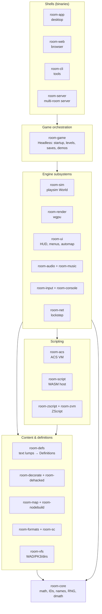
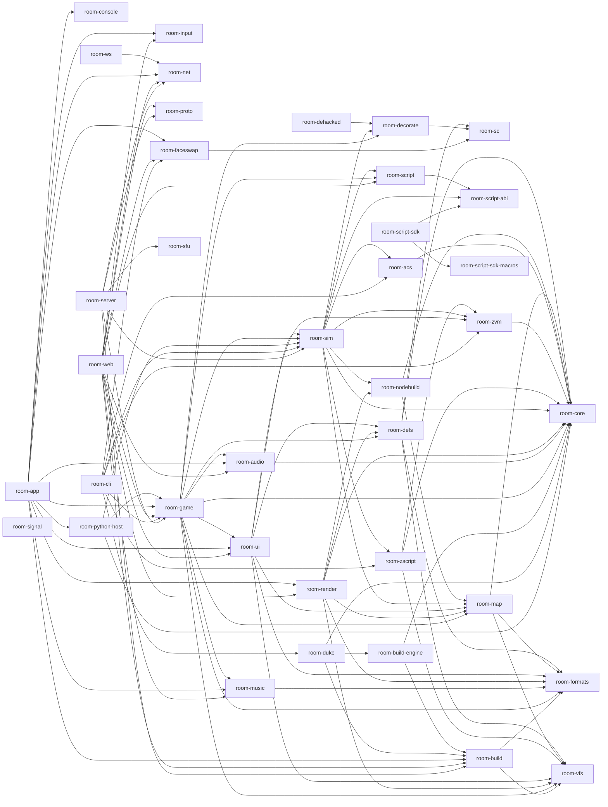
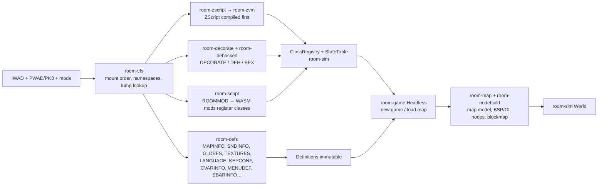
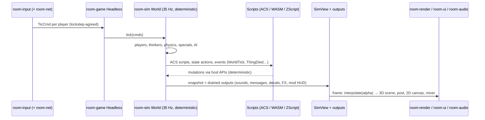
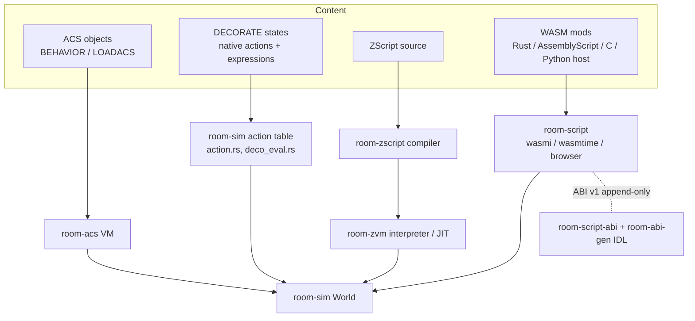
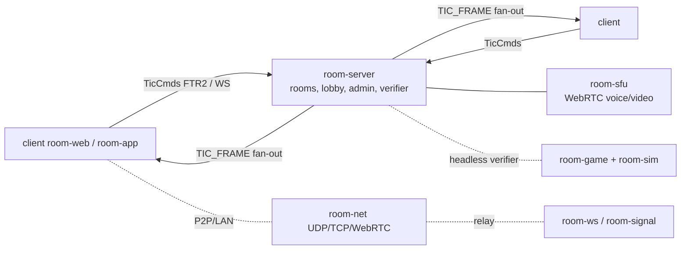

# 35 — Room engine reference (one page)

Pure-Rust, library-first re-implementation of the ZDoom/GZDoom family
(+ Duke Nukem 3D / Build), with a wgpu renderer for desktop and web, lockstep
netplay, a multi-room server, WASM mods and a ZScript VM.
41 crates, ~350 k lines of Rust (2026-11-01). Rules: `AGENTS.md`;
details: `docs/00`–`34`.

## 1. Layers

## 2. Crate dependency graph (internal deps only)

(`room-app`, `room-web`, `room-cli`, `room-server` also use most content crates
directly; edges omitted for readability. `room-script-sdk` is linked by **guest**
mods compiled to wasm32, never by the engine.)

## 3. Startup / load pipeline

## 4. Runtime: one tic and one frame

Key rule: **the renderer never mutates game state**; everything inside a tic is
bit-reproducible on x86-64 / aarch64 / wasm32 (no HashMap iteration, no std
transcendental floats, no wall clock, no threads — `room_core::dmath`, playsim RNG).

## 5. Scripting stack

## 6. Networking and server

Every peer runs the full sim from the same inputs (lockstep); the server
relays inputs, compares checksums, and can verify headless. Mods (WASM WAD,
ZScript in PK3) are fingerprinted so all seats run identical bytes.

## 7. Crate reference

| Crate | Layer | LOC | Role | Doc |
|---|---|---:|---|---|
| room-core | base | 3.0 k | math, fixed/float types, names, IDs, RNG, deterministic `dmath` | 01, 02 |
| room-sc | content | 0.9 k | ZDoom text scanner shared by all text-lump parsers | 05 |
| room-formats | content | 3.0 k | binary lumps: patches, flats, palettes, sounds, music, demos, PNG/OGG/FLAC | 04 |
| room-vfs | content | 2.4 k | WAD/PK3/PK7/dirs, load order, namespaces, IWAD detection, nested WADs | 03 |
| room-defs | content | 9.1 k | text lumps → immutable `Definitions` (MAPINFO, SNDINFO, GLDEFS, TEXTURES, …) | 05 |
| room-decorate | content | 3.8 k | DECORATE parser + expressions → ClassDef IR | 11 |
| room-dehacked | content | 2.2 k | DeHackEd/BEX/MBF21 patches on the IR | 11 |
| room-map | content | 9.2 k | map model, Doom/Hexen/UDMF loaders, blockmap, reject | 06 |
| room-nodebuild | content | 1.4 k | internal BSP + GL nodes (ZDBSP-equivalent) | 06 |
| room-sim | engine | 76.5 k | playsim `World`: actors, thinkers, physics, specials, inventory, weapons, AI, mod HUD, FX events | 07, 08, 09, 30 |
| room-acs | script | 7.3 k | ACS loader + VM (ACS0/ACSE/ACSe) | 10 |
| room-script-abi | script | 1.4 k | `no_std` ABI types/constants shared by host and guests | 12 |
| room-script | script | 4.1 k | WASM host: validation, budgets, registration, game imports | 12, 31 |
| room-script-sdk (+ macros) | guest | 2.4 k | Rust guest SDK for mods (`RoomMod`, `export_mod!`, HUD, art/sound) | 12 |
| room-abi-gen | tool | 0.1 k | IDL → host glue, Rust/C/Zig/AS bindings | 12 |
| room-zscript | script | 4.2 k | ZScript lexer, preprocessor, parser, semantics, bytecode compiler | 34 |
| room-zvm | script | 3.0 k | ZScript register VM: interpreter, heap, GC, natives | 34 |
| room-render | engine | 20.1 k | wgpu renderer: BSP walk, portals, sprites/models/voxels, lights, post, 2D canvas | 13, 29 |
| room-render-soft | engine | stub | classic CPU renderer (stretch) | 13 §12 |
| room-ui | engine | 7.2 k | `UiDrawList`, fonts, menus, status bars/SBARINFO, HUD, automap, intermission | 16 |
| room-audio | engine | 0.5 k | mixer, SFX, positional audio, reverb, backends | 14 |
| room-music | engine | 1.4 k | MUS/MIDI, SoundFont, OPL3, trackers, streams | 14 |
| room-input | engine | 0.9 k | devices, bindings, TicCmd building, mod buttons | 15 |
| room-console | engine | 1.6 k | console, commands, CVars, config | 15 |
| room-net | engine | 3.6 k | lockstep sessions, UDP/TCP/WS/WebRTC transports, desync detection | 17 |
| room-game | game | 28.2 k | `Headless`: startup, levels, hubs, intermission, saves, demos, mod loading | 01, 17 |
| room-faceswap | feature | 2.5 k | face capture alignment + sprite-head compositing | 26 |
| room-build | Duke | 21.2 k | GRP/ART/MAP readers, converter to a Room UDMF WAD | 23 |
| room-build-engine | Duke | 5.2 k | Build world model + clean-room primitives | 25 |
| room-duke | Duke | 64.1 k | native Duke 3D runtime: CON compiler/VM, game logic, 30 Hz | 25 |
| room-python-host | feature | 0.5 k | optional Python play mods (desktop) | — |
| room-proto | server | 1.0 k | wire types/codecs, protocol v2 (FTR2) + JSON control | 22 |
| room-server | server | 9.8 k | multi-room WS server: lobby, admin, verifier, mods, BR stats | 22, 28 |
| room-sfu | server | 1.2 k | WebRTC SFU for voice/video | 22 §8 |
| room-ws | server | 0.3 k | WebSocket packet relay | 17 |
| room-signal | server | 0.3 k | WebRTC signalling helper | 17 |
| room-app | shell | 8.6 k | desktop binary (winit + wgpu + cpal) | 18 |
| room-web | shell | 12.1 k | browser shell (wasm-bindgen, WebGPU/WebGL2, editor) | 18 |
| room-cli | shell | 2.1 k | tools: WAD, maps, nodes, demos, Duke traces, ZScript check, render-to-PNG | — |
| room-testkit | test | 1.0 k | UDMF map builder DSL, headless scenario runners | 20 |

## 8. Where to start
- **Gameplay bug** → `room-sim` (`world.rs`, `action.rs`, `think_player.rs`), tests in `room-sim` / `room-game/tests`.
- **Content won't load** → `room-vfs` → `room-defs` / `room-decorate` → `ClassRegistry` (`room-sim/src/class.rs`); `room-cli` to inspect.
- **Visual bug** → `room-render` (`pass.rs`, `shaders/`, `frame.rs`), goldens in `testdata/goldens`.
- **Mod API** → `room-script-abi/api/*.ron`, `room-script/src/game.rs`, `room-sim/src/script_mods.rs`, SDK.
- **Netplay/desync** → `room-net`, `room-server`, `World::checksum`.
- **Progress & plans** → `docs/21` (milestones), feature specs `docs/26`–`34`.
